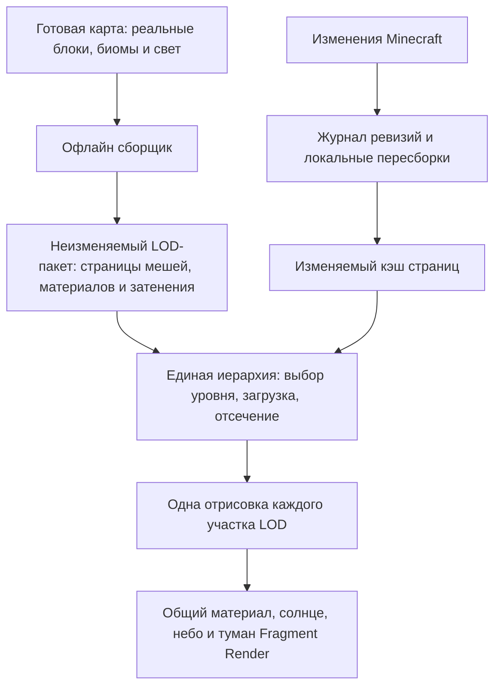

# Fragment Vision: собственная LOD-система для подготовленной карты

Статус: архитектурное исследование и план, **не реализованная новая система**. Решение от 2026-10-24 заменяет направление эксперимента `hybrid-wip`. Основание — уточнение пользователя: весь мир заранее сгенерирован и скачан игроком; во время игры сохраняется возможность копать и строить.

## Цель и ограничения

Сохранить 6–12 чанков обычного Minecraft/Sodium. За ними показывать собственную текстурированную LOD-геометрию: плавный естественный рельеф, узнаваемые деревья и постройки, непрерывные материалы, свет, тени и воздушную перспективу Fragment Render. Убрать крупные кубические ступени естественных гор и холмов. Достичь измеримого выигрыша относительно исходного порта Voxy или как минимум не увеличивать нагрузку при согласованном качестве.

**Новая система заменяет проход геометрии Voxy.** Постоянного `Voxy + дополнительная поверхность` в целевой архитектуре нет. Источник воксельных данных, загрузчик карты или приёмы управления памятью могут остаться; это не означает сохранения старого draw-прохода. Каменные дома, лестницы и изменения игрока должны сохранять форму: требование гладкости относится к естественному рельефу, не ко всем блокам мира.

Предгенерация позволяет вынести извлечение поверхности, упрощение, подготовку материалов и части затенения в офлайн-сборку карты. Она **не делает бесплатными** отрисовку, чтение с диска, декомпрессию и обновления после изменений. Преимущество над Voxy возможно в этом более узком сценарии, но не доказано для всех сцен и GPU. Обязательные измерения описаны в [performance.ru.md](performance.ru.md).

## Что выяснено по коду и измерениям

Проверены Vision `191e90db`, Render `95ec97c`, исходники upstream Voxy `5bf33350a1cc7bb7e2b5d947b236c56d878b8a7d`, Ecstatic `41dea8df4f60d2a07fcd99424316646fb232effe`. Ссылки и границы применимости — в [upstream-review.ru.md](upstream-review.ru.md).

Текущий WIP выполняет `HybridTerrain.render` после исходной opaque-геометрии. `MDICSectionRenderer` продолжает отправлять исходные quads, а шейдер отбрасывает заменённые фрагменты по coverage. Это не экономит их хранение и обработку вершин. В проверенной игровой сцене добавочные меши занимали 429 MiB, а обзорный кадр отправлял примерно 2.5 млн **добавочных** треугольников. Это не число всех треугольников кадра и не измерение GPU FPS.

Синтетический тест сравнил shipping `ScanMesher2D` с `HybridVoxelMesh` на одинаковой поверхности. На холмах: 3338 треугольников у объединённых граней и 1623 у дальнего меша. На неровном рельефе: 6958 и 8983. На ровной площадке: 8 и 254. Следовательно, «сглаженный» не означает «дешёвый», а квадратная сетка фиксированной плотности не заменяет хорошее упрощение. Полные условия — [предыдущий отчёт](../hybrid-wip/geometry-benchmark.ru.md); это не полный игровой A/B.

## Что пошло не так

1. Проверка внешнего вида стала вторым постоянным рендерером. Замена должна была происходить до формирования draw-команд.
2. Сначала размножались грани вокселей, затем двигались их вершины. Это сглаживало часть ступеней, но оставляло много геометрии. Первые варианты даже отправляли схлопнутые треугольники; последующее удаление части индексов не сделало компактными все потоки вершин.
3. Монолитный объём приводил к большим временным массивам и OOM. Плитки исправили пик рабочей памяти, но не стоимость хранения и рисования результата.
4. Построение зависело от текущей камеры и native-маски. Движение вызывало работу, которую для заранее подготовленного мира можно выполнить один раз.
5. Первый heightfield терял объёмную структуру, путал материалы склонов и выглядел кусками. Его отказ не означает, что любой гладкий LOD плох; это отказ от конкретного извлечения поверхности и окраски.
6. Материалы WIP слишком упрощены: `catalog()` берёт преимущественно UP-спрайт, приводит блок к default state, уменьшает слой до 32×32 и использует grass-provider при подготовке tint. Такой каталог нельзя использовать как общий контракт для камня, снега, травяных боков и модовых блоков.
7. Деревья остались в старой кубической схеме. В `quads3.vert` передаётся `fr_CanopyNormal = vec3(0)`, поэтому linked High не получает нормаль кроны, которой пользуется native-листва.
8. Дальняя геометрия получает native shadow map только в её области. Сейчас её радиус ограничен 96–192 блоками (160 при 8 чанках). За границей нет полноценного дальнего солнечного затенения. Общая яркость, туман и blur это не исправляют.
9. Подсчёт только новых треугольников создаёт ложное впечатление оптимизации. Нет аппаратного игрового A/B, а llvmpipe не предсказывает результат RTX 2060 Super.

## Выбранное направление

**Офлайн подготовленная иерархия компактных текстурированных мешей + локальный изменяемый слой + один собственный backend LOD.** Первое доказательство строится на небольшом фрагменте реальной карты, затем масштабируется.

### 1. Источник данных и офлайн-сборка

- Читать действительные сохранённые чанки `.mca`, включая декорации, пещеры, навесы, воду, постройки и изменения автора карты. Сид и повторный вызов генератора не являются источником истины.
- Сначала обеспечить полноту карты, биомов и исходного sky/block light. Пустая секция, неизвестная секция и отсутствующая страница — разные состояния. Не выдавать неизвестное за воздух.
- Данные разделить на естественный рельеф, точные объекты/постройки, кроны/стволы, воду и мелкие декорации. Визуально удаляемые растения не удаляются из самой карты.
- Создать ограниченные пространственные страницы с halo для локальных вычислений. Первым кандидатом служит ячейка 32 или 64 блока; размер выбрать измерениями, а не закреплять старое 1088×1088 окно.
- Страница может содержать несколько высотных слоёв и объёмных компонентов. Единственная высота Y на XZ не подходит для всего мира: она заполняет арки, пещеры, мосты и навесы.
- В офлайн-пакет включить все уровни и консервативные bounds/error, таблицы соответствия границ, материалы и сжатые блоки данных. Тяжёлую оптимизацию запускать у автора карты. Клиент читает готовые страницы.
- Для конечной карты задать игровую границу внутри подготовленной территории и подготовить запас за ней под видимую дальность/тени. Само наличие скачанной карты не запрещает Minecraft генерировать новые чанки при выходе за её край: это обеспечивается отдельно world border/правилами сервера. Край известной карты не изображать как повреждённый кэш.
- Каноническими остаются блоки Minecraft. LOD-пакет — производное представление, не замена сохранения мира и коллизий.

### 2. Извлечение и упрощение рельефа

Основной кандидат: объёмная граничная поверхность с ограниченным сглаживанием естественного рельефа, затем упрощение с учётом геометрической ошибки и важных атрибутов (класс QEM/attribute-aware simplification). Рассмотреть surface-nets/dual-подобное извлечение как альтернативу исходной поверхности, но не переносить наивное усреднение вершин старого WIP.

У алгоритма две разные задачи: художественно убрать блоковые ступени и затем сократить геометрию. Ошибку нужно оценивать относительно **принятой гладкой поверхности**, а отклонение этой поверхности от настоящих блоков ограничивать отдельно. Иначе лимит «1 пиксель от блоков» будет сохранять каждую ступень, либо сглаживание незаметно разрушит исходную географию.

Обязательные ограничения:

- Сохранить крупные гребни, силуэты, обрывы, входы в пещеры, просветы под арками, береговые линии и водные уровни. Не сглаживать всё до одинаковых холмов.
- Снег остаётся покрытием соответствующих поверхностей. Нельзя назначать его всей стене по верхнему образцу колонки. Не строить объём снежной горы из тонкого слоя снега.
- Постройки и защищённые изменения имеют точные границы. «Камень = природа» неверно: каменный дом и выкопанная ступень могут состоять из тех же блоков. Нужны авторские маски/метаданные и журнал изменённых областей; неизвестные конструкции сохранять консервативно.
- Не держать независимую материальную границу на каждом микроблоке. Большие значимые границы сохранять, мелкий рисунок переносить в материальную карту. Иначе ограничения упрощения оставят почти всю исходную сетку.
- Получать отдельные компактные vertex/index страницы уровней. После упрощения удалять неиспользуемые вершины, оптимизировать порядок чтения и квантизовать локальные координаты/нормали. Учитывать ошибку квантизации в общем бюджете.
- Не хранить постоянно пять `vec4` и все morph-цели на каждую исходную вершину, как в WIP. Один необходимый переходный target допустим только для активного перехода и в измеренном бюджете.
- Ошибка родителя включает отклонение от принятой исходной поверхности, а не только от уже упрощённого ребёнка; иначе ошибки накопятся незаметно. Упаковка/кодек не должны менять face-material при перестановке индексов или provoking vertex.
- Не требовать mesh shaders/Nanite-подобного движка в первом прототипе. Достаточны индексированные меши и пакетные indirect draws на существующем GL backend.

На гладких простых областях сетка должна становиться очень редкой. Сложный утёс закономерно требует больше геометрии. Если выбранный метод не достигает бюджета без потери формы, это ограничение результата, а не повод скрыть утёс дымкой.

### 3. Единая иерархия и отрисовка

У узла: bounds, geometric/material error, child coverage, версии данных, ссылки на страницы и оценка стоимости. Выбор уровня учитывает расстояние, FOV и разрешение: ориентир `errorPixels ≈ errorWorld × screenHeight / (2 × tan(verticalFov/2) × distanceToBounds)`. Это оценка; силуэт и экраны с разных направлений проверяются отдельно. Не использовать только кольца фиксированной дальности.

На каждом кадре выбирается непересекающееся покрытие: родитель **или** его готовые дети. Нельзя одновременно рисовать полный родительский рельеф и его замену. Оpaque/cutout/water могут иметь разные очереди внутри одного backend; это не второй мир.

- Frustum и консервативное occlusion culling, ограничения очередей, приоритет видимых и ближайших страниц.
- Готовый родитель остаётся до атомарной публикации полного набора детей. Ошибка загрузки не оставляет дыру.
- В активной сцене находятся только необходимые уровни и ограниченный резерв перехода. Все уровни карты на GPU не загружаются.
- Общий бюджет RAM/VRAM включает страницы, атласы, очереди, метаданные и временно старую/новую версию, а не только один тип буфера.
- Перемещение камеры меняет выбор/резидентность. Оно не запускает извлечение земли из блоков повторно.
- При телепорте быстро показать грубые заранее подготовленные страницы, затем уточнять. Occlusion-history после резкого перемещения сбрасывать консервативно.

Точные постройки можно представлять компактными объединёнными гранями внутри новой системы, если это выгодно. Это не возвращение кубических естественных гор и не вызов старого прохода Voxy. В исследовательском A/B старый и новый backend переключаются целиком и взаимоисключающе.

### 4. Переходы от настоящих чанков

Нужен отдельный контракт границ. Общий halo сам по себе не решает стык разных уровней, особенно после квантизации.

Первый LOD сохраняет точную поверхность на границе с native и постепенно переходит к принятой гладкой поверхности. Граница следует **фактически готовым** render sections Sodium, включая высоту, а не только квадрату `renderDistance`. Изменение дальности и частичная готовность чанков не должны открывать щели.

Для начала: фиксированный канонический контур стыка и переходная полоса, собираемая по варианту соседей. Между LOD — согласованные контуры и stitch-геометрия с ограниченной разницей соседних уровней. Сначала обеспечить отсутствие щелей и двойного покрытия, затем добавлять morph. Нельзя морфить несвязанные вершины разных топологий без соответствия.

На первых шагах блоковый силуэт у границы неизбежно присутствует: это короткая переходная полоса, а не кубические горы вдали. У гладкой поверхности и native блоков разные положения; идеально мгновенная смена без полосы/перехода невозможна. Ширину выбирать по экранной ошибке и сценам с 6, 8 и 12 чанками.

Не закрывать швы длинными вниз вытянутыми skirts: они дают стены, меняют тени и закрывают пещеры. Ограниченные технические skirts допускаются только как отдельно проверенный fallback, не основное решение. Не делать постоянный alpha-crossfade двух полных рельефов: он удваивает работу и портит depth. Короткие локальные переходы должны иметь явный бюджет.

### 5. Изменения игрока

Пакет карты неизменяемый. Над ним хранится локальный writable overlay: block/section revisions, готовые заменяющие страницы и **tombstones** для удалённых данных. Удаление overlay-записи не должно «воскрешать» страницу исходной горы.

Поток обновления:

1. Minecraft меняет блоки и свет; обычные чанки сразу отражают изменение.
2. Пометить затронутые ячейки, соседей по halo/границам и зависимые родительские уровни. Изменение света/биома без изменения формы должно уметь обновлять только нужные данные.
3. Снять согласованный snapshot фактических блоков и его revision. Worker не читает изменяемый live-world без безопасного снимка.
4. Быстро построить локальную точную замену, если старая страница уже видна. Затем в фоне подготовить упрощённую версию и родительские страницы. Частые изменения объединять в ограниченные задания.
5. Перед публикацией проверить revision, материал-пакет и состояние соседних границ. Устаревший результат не заменяет свежий. После GPU fence освобождать старые буферы.
6. Обновить кэш на диске атомарно. При перезапуске восстановить overlay; повреждённую производную страницу пересобрать из карты.

Грубый предок, включающий изменённую область, временно запрещается как представление этой области: иерархия спускается к обновлённым детям/точной замене. Нельзя бесконечно оставлять старую гору поверх выемки. Если правок слишком много, ограниченная деградация детализации и задержка фонового упрощения лучше неограниченной очереди и OOM; это обязательно измеряется.

Офлайн-изменение `.mca`, новая версия скачанной карты, смена измерения и откат сохранения также инвалидируют соответствующие страницы. Для мультиплеера локальная исходная карта не знает далёких изменений сервера: потребуется серверный поток ревизий/обновлений или явное ограничение актуальности. Предгенерация эту проблему не решает.

### 6. Как сохранить материалы и избежать «мыла»

Геометрический LOD и текстурный mip — независимые решения. Большой треугольник способен показывать подробную повторяющуюся текстуру.

Базовый вариант: повторяющиеся block/material текстуры в texture arrays, стабильные world/object coordinates, отдельная карта крупных материалов и биомного оттенка. У скал — согласованная проекция боков, у дёрна — верх и земля/травяная кромка, у снега — своя маска покрытия. Простая доминирующая проекция выбирается офлайн; более дорогой triplanar только там, где оправдан измерением.

Материальная карта не должна превращать каждую гору в один RGB или усреднять снег, камень и траву вместе. Для сложной многослойной поверхности карта привязана к surface patch/UV, не к одной XZ-колонке. Для редких авторских деталей можно использовать страницы запечённого **albedo**, но не запекать туда дневной свет, туман и тени. Текстурный бюджет и идентичность ресурспака входят в manifest.

- Сохранять плотность texel в мировых единицах; не растягивать одну плитку на целую гору.
- Mipmaps нужны: без них удалённая листва и трава мерцают. Использовать корректные производные UV, подходящую фильтрацию, разумную anisotropy для наклонных поверхностей. Не ставить отрицательный mip bias на всё и не фиксировать самый подробный mip до горизонта.
- Цветовые mip-уровни строить с учётом пространства цвета; прозрачную листву — с корректным весом alpha и сохранением покрытия. Отделять cutout от tint-mask, чего текущий экспериментальный каталог не делает универсально.
- Не смешивать соседние материалы в mip атласа: arrays либо padding/gutters на каждом mip. ID материала не является интерполируемым цветом.
- Сохранять различие геометрической нормали, нормали освещения кроны и мелкого рисунка. Нормали не должны скачком менять яркость при смене уровня.
- Воздушная перспектива уменьшает контраст по физически/художественно заданной колонке, сохраняя силуэт. Дополнительный экранный blur не используется для сокрытия дефектов сетки. В нынешнем WIP `fr_AerialSoftness=0` уже полезен.
- Нельзя обещать отдельные листочки меньше пикселя. Цель — устойчивые, чётко читаемые массы крон и границы материалов, без мерцания и лишнего размытия.

Вшивание согласованного ресурспака в Fragment Render даёт стабильные материалы и управляемые mip-цепочки. Само по себе оно не исправляет сетку или фильтрацию. Изменение пака должно иметь версию и инвалидировать зависимые данные; геометрию пересобирать только если поменялись форма/классификация/alpha-зависимые прокси.

### 7. Растения и деревья

Мелкие декоративные объекты — травинки, цветы, папоротники, bushy-карточки, небольшие частицы листвы — исключаются из LOD bake, теневых прокси и material occupancy, чтобы после удаления не остались «пеньки» грубых вокселей. Исходные блоки сохраняются. Классификация через явные теги/правила; не удалять подряд всё, что похоже на растение (крупные грибы, кактусы, большие декоративные кусты и урожай могут быть значимыми).

Вблизи границы мелкая зелень плавно теряет видимость внутри native-области; средний цвет поверхности согласуется с травой Fragment Grass. LOD не получает геометрию травинок. Ground albedo/палитра сохраняют характер поляны без кислотного зелёного пятна.

У upstream Voxy нет обнаруженной отдельной системы «ботанических деревьев»: листва проходит через block models, шестигранные baked faces и обычную voxel-иерархию. Сохранять полезно исходные материал/вид листвы/биом, отсечение закрытых граней и компактность. Текущий порт уже исключает bushy из LOD-моделей; это сохранить.

Для новой системы кандидат — **прокси реальных крон**, построенные по фактическим leaves/logs:

- Средняя дистанция: компактная объёмная крона с несколькими характерными лопастями и простым стволом, ограниченные cutout-края; форма и разрывы должны соответствовать исходному дереву.
- Дальше: объединение крон в более редкие пространственные кластеры с сохранением просветов и силуэта леса. Один связный лес из соприкасающейся листвы не должен стать одной огромной массой. Разделять по пространству и структуре, а не только connectivity.
- Billboard/impostor — отдельный кандидат для самых дальних уровней, если он выигрывает по пиксельной стоимости. Большое число прозрачных карточек может быть дороже простых непрозрачных крон. Если использовать impostor, нужны данные для переосвещения (albedo/normal/depth/coverage), а не фотография с навсегда запечённым полуденным солнцем.
- Birch, oak, spruce и модовые виды сохраняют отдельные tint-domain/material ID. Нельзя повторно применить grass tint к листве или склеить модели только по одинаковому RGB.
- Передавать нормаль кроны, sky visibility/локальную occlusion и материал в общий свет Render. Освещение должно формировать крупные объёмы, а alpha-текстура — детали края.
- Вырубка/рост дерева, пожар, persistent/player-placed leaves инвалидируют соответствующие кластеры и предков. Кроны не являются неизменяемым украшением подготовленной карты.

### 8. Свет, тени и связь с Fragment Render

Расширять существующий `AtmosphereBridge` версионированным контрактом. Сохранять один источник sun/sky/weather/time, BiomePalette и art-параметров. Render владеет светом, небом, атмосферой и настройками; Vision владеет страницами мира, видимостью и геометрией. Оба модуля явно проверяют поддерживаемые возможности.

Новый вход материала: untinted base albedo либо явно помеченный уже tinted albedo; material/tint-domain ID; camera-relative position; геометрическая и shading-normal; sky/block light; AO/sky visibility; доступная видимость солнца. Формат не должен заставлять новый меш сначала умножать на vanilla lightmap, а затем делить обратно. Native адаптер может сохранять старую схему, но общий shading после декодирования должен совпадать.

Сейчас `lighting_high.glsl` рассчитан на захваченный `fr_BaseLight`, а его новая поверхность вручную передаёт `vec3(1)`. В новом контракте это явное различие входов, а не неявная договорённость. Двойные biome tint, directional face shade, AO, gamma conversion и fog запрещены. Не удалять baked native shade повсюду одним коэффициентом: сначала привести оба пути к одному смыслу входов.

Нужны единые пространства координат, матрицы, depth convention/reversed-Z, порядок tone mapping и пространство цвета. LOD пишет корректную глубину для native occlusion, воды/отражений и эффектов; это не нарисованная поверх мира картинка. Opaque, cutout, translucent и вода имеют определённый порядок. Атмосфера накладывается один раз. На первом этапе можно сохранить текущий LOD color+depth composite с общим воздухом; его стоимость входит в A/B. Прямое объединение с основным target — последующая оптимизация после проверки совместимости.

**Тени — отдельная статья бюджета.** Общий солнечный цвет не даёт теней от далёких гор и деревьев.

- У перехода переиспользовать native shadow map. Дополнять её недостающими LOD caster-прокси внутри её области можно только с общим owner-mask, чтобы не рисовать дубль native-дерева.
- Для базового дальнего света исследовать заранее рассчитанные sky-occlusion и направленную видимость солнца на surface patches/кронах. Для открытого рельефа возможны horizon-профили по направлениям. Их нельзя считать полноценной картой теней для всех навесов и этажей: для них нужны отдельные поверхностные образцы/прокси.
- Такие данные хранят **видимость**, а цвет и энергия света рассчитываются Render по текущему времени и погоде. Это позволяет менять день/закат без запекания отдельного цветного мира на каждый час.
- Цена: дополнительные страницы и выборки; изменение высокого препятствия может изменить дальнюю тень далеко за пределами его ячейки. Ограничить дальний радиус зависимостей/расписание, помечать старую видимость, смешивать к нейтральной до обновления. Нельзя обещать мгновенные точные глобальные тени при локальной пересборке.
- Отдельная грубая shadow-map/clipmap для High — только кандидат после измерений, с ограниченным покрытием, обновлением и caster budget. Это дополнительный проход, не бесплатная часть замены. В базовом сравнении он выключен либо имеет равноценный counterpart у Voxy.
- Cloud shadows используют то же поле и world position, что native. AO/затенение кроны не выдавать за directional sunlight shadow. На закате/ночи не оставлять дневной свет в текстурах.

Подробный проект API и проверки должны появиться в Render до включения нового backend по умолчанию. В этом исследовании shader code не изменяется.

## Хранение и совместимость

Manifest пакета: format/schema version, UUID и ревизия карты, dimension, координатные bounds, hash block registry/правил материалов, pack/palette version, версия baker, единицы/quantization, кодек, checksum и индекс страниц. Хранить стабильные block/resource identifiers, не runtime registry ID одного запуска.

Base archive читается random-access, overlay имеет приоритет и tombstones. Геометрия, материалы и затенение версионируются независимо, но публикуются совместимым набором. Лимиты распаковки и размера страницы обязательны. Пропавшая/повреждённая страница использует готовый предок или bounded local rebuild, не чтение всей карты в RAM.

Низкие уровни можно держать на диске, дальние родители — в небольшом закреплённом резерве. Величина пакета зависит от площади карты, сложности и материалов; размер `.zip` не равен VRAM. До обещаний «можно хоть 5 ГБ» замерить MB на км²/регион, decode throughput и объём resident working set на реальной карте.

## Что сохранить и что вывести из production-пути

| Часть | Решение |
|---|---|
| Текущий WIP и его результаты | Сохранить как историю и сравнение; оставить выключенным по умолчанию |
| Дублирующий HybridTerrain поверх MDIC + shader coverage discard | Удалить из нового backend; не оставлять как штатную замену |
| Монолит/камера-зависимое извлечение мира, фиксированные пять vec4 morph | Не переносить |
| Простое усреднение цветов, UP-only каталог, grass tint для всех слоёв | Заменить материальным контрактом и корректными surface maps |
| Heightfield как единственное представление всего мира | Отказаться; допустим только явно проверенный fast path для однозначной поверхности |
| Плитки, bounded queues, revision checks, отмена worker, освобождение CPU payload | Сохранить принципы и проверки |
| Shared Render palette, air, sun/sky, shader compile fixtures, material audit | Сохранить и расширить |
| Фильтр bushy в LOD | Сохранить; расширить правила мелких декораций |
| Voxy import/storage/mapping, hierarchy, Hi-Z, indirect batches, upload arenas | Исследовать повторное использование/адаптацию с учётом API и лицензии; не переписывать вслепую |
| Старый Voxy renderer | Контрольный backend для A/B; в новом режиме не запускается |

«Вывести» означает удалить из активной новой архитектуры после готовности замены, а не стереть историю и исходники сейчас. Удаление старого fallback до устойчивого собственного покрытия оставит игрока без дальнего мира.

## План реализации и точки остановки

| Этап | Результат | Условие перехода дальше |
|---|---|---|
| 0. Baseline | Зафиксированные сцены и Voxy-only профиль с общим Render | Измерены кадр, LOD, память, потоковая загрузка; условия воспроизводимы |
| 1. Офлайн proof | Несколько реальных tiles: холмы, скалы, берег, пещера, дом; compact meshes и материалы | Видно гладкий рельеф, правильные материалы; при заданной ошибке payload/triangle не растут бесконтрольно |
| 2. Собственный draw | Взаимоисключающий Mesh backend, без исходного MDIC terrain draw | Счётчики подтверждают отсутствие двойной геометрии; родитель/дети и depth корректны |
| 3. Стыки и streaming | Native→LOD и LOD→LOD, bounded resident pages, телепорты | Нет дыр, стен/перекрытий и скачков цвета; движение не вызывает извлечение земли |
| 4. Изменяемый мир | Журнал, локальные exact patches, асинхронные родители, restart | Выемка/постройка не возвращается старым LOD; ограниченные очереди и память |
| 5. Деревья и Render | Crown proxies, удалённая мелкая зелень, общий material/light/depth contract | Birch/oak/spruce согласованы с native днём, в тени, на закате и ночью |
| 6. Дальний свет | Измеренный способ occlusion/visibility, при необходимости отдельный High shadow option | Красота не маскирует потерю performance target; цена указана отдельно |
| 7. Карта целиком | Версионированный пакет, проверки повреждения, большой маршрут | Выполнены performance gates и визуальная приёмка |

Если этап 1 не даёт приемлемой формы при меньшей стоимости, менять извлечение/упрощение на малом тесте. Если этап 2 проигрывает по GPU, искать реальное ограничение (пиксели, bandwidth, overdraw, shaders), а не добавлять ещё уровни наугад. До gates система остаётся экспериментальной.

## Риски, которые нельзя повторять

| Риск | Защита / проверка |
|---|---|
| Издержки нового render pass съедают экономию | Один backend, счётчик полных draw-команд и GPU time |
| Гладкие скалы становятся пластилином | Контроль гребней/материалов и художественная эталонная поверхность |
| Слишком много UV/material швов мешают упрощать | Material maps для мелких деталей; сохранять только значимые границы |
| Материалы/листва превращаются в одно пятно | Независимая детализация материалов, правильные mip/alpha/normal, диагностический albedo |
| Недостаток деталей скрывается fog/blur | Сравнение с отключённой атмосферой плюс финальный художественный кадр |
| Щели LOD и разные результаты quantization | Общие границы и единая сетка квантования соседей; движущийся camera test |
| Native готов частично, а mask удаляет весь квадрат | Владение по реальным render sections и безопасная публикация |
| Работа при каждом движении камеры | Неизменяемые mesh pages, только selection/residency |
| TNT/пожар/массовое строительство создают бесконечную очередь | Coalescing, лимит snapshot/jobs/bytes, revision cancellation |
| Память удваивается при замене | Бюджет с overlap, fence retirement, свободный резерв заранее |
| Удалённые блоки возвращаются из base | Tombstones, revision chain, тест save/restart |
| Кроны скрывают просветы и становятся «ватой» | Ограниченные canopy clusters, контроль силуэта и overdraw |
| Тени исчезают за native radius | Явный дальний visibility policy, плавный согласованный переход |
| Texture pack update делает stale цвета/модели | Manifest и раздельная инвалидизация материала/геометрии |
| Обновление upstream ломает NeoForge/Sodium/depth | Аудит конкретных изменений; без массового переноса новой ветки |
| Результат на llvmpipe выдан за FPS RTX | Аппаратный gate; software test только проверяет корректность |

## Что сделано в этой итерации

Изучены исходники текущих двух модов, зафиксирован свежий upstream Voxy и просмотрены его механизмы данных/рендера, сопоставлен подход Ecstatic и кандидат упрощения meshoptimizer. Подготовлены эта архитектура, аудит источников и протокол измерений. Сохранён предыдущий синтетический benchmark как свидетельство ограничений WIP. Новый renderer, bake формат, дальние тени и деревья **ещё не реализованы**; преимущество по FPS не заявляется.
