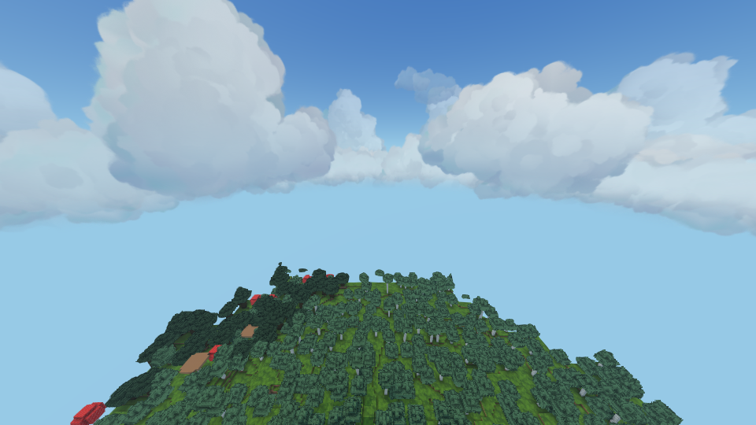
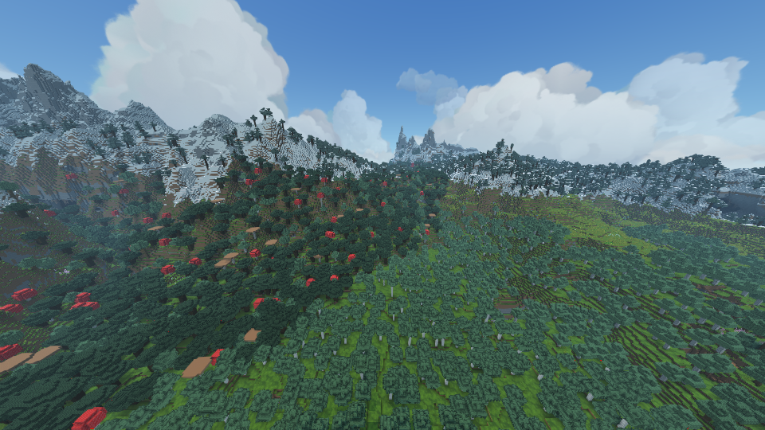
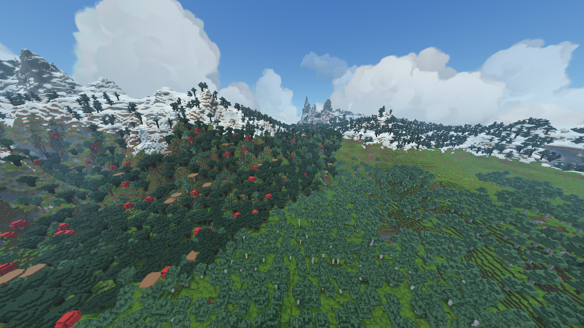

# LOD с воздуха: сохранённый запуск и состояние ветки

25 октября 2026. Результаты получены **до просьбы не проводить тесты**.
После неё новые игровые запуски, проверки и замеры не выполнялись.
Последняя упаковка GPU-вершин и завершающие правки профиля в этих кадрах
ещё не использовались. Исторические `runtime-proof/` и `offline-proof/`
также не являются проверкой финального содержимого ветки.

## Условия

Minecraft 1.21.1 / NeoForge 21.1.262 / Java 21. Sodium 0.8.13, Lithium 0.15.4,
FerriteCore 7.0.3, ModernFix 5.27.27, Entity Culling 1.11.3,
ImmediatelyFast 1.6.15, Chunky 1.4.23. Fragment Render 1.1.0 со встроенным
мировым шейдером, Fragment Grass 1.4.5-private.2, Fzzy Config и Kotlin for Forge.
Версии, хеши и установка: [профиль](../../../tools/lod/test-pack/README.ru.md).
Iris исключён из профиля, поскольку отключает адаптер шейдера Fragment Render.

Программный OpenGL **llvmpipe**, лимит CPU — два ядра, аппаратной видеокарты нет.
Окно 960×540, FOV 90, обычные чанки — 6, simulation distance — 5,
Fragment Render Medium, тени 1024. Камера `(512.5, 180, 700.5)`, yaw 0°, pitch 20°.
Спавн мобов отключён, время и погода фиксированы. Seed 1234.

Chunky подготовил квадрат радиуса 768 блоков вокруг `(512, 700)`.
Предыдущая проверка региональных файлов подтвердила сохранение всех **9409**
целевых чанков со статусом `minecraft:full`: [source-chunks.json](source-chunks.json).
Импорт Vision включил также чанки за пределами целевого квадрата.

## Уже полученные цифры

Медианы сохранённых кадров на программном рендерере, не прогноз FPS на видеокарте.
Режим «обычные чанки» не рисует дальний мир и служит оценкой стоимости остальной
сцены, а не вариантом равного качества.

| Режим | Кадров | Весь кадр, мс | Проход Vision, CPU, мс | Проход Vision, GL timestamps, мс |
|---|---:|---:|---:|---:|
| Только обычные чанки | 120 | 280.03 | 0 | — |
| Исходный воксельный LOD этой ветки | 120 | 940.30 | 661.19 | 657.03 |
| Гибрид, раннее отсечение включено | 60 | 2136.02 | 1869.11 | 1865.81 |

Гибрид здесь **медленнее** исходного воксельного режима. Это не отдельное сравнение
с актуальным upstream Voxy. Замера гибрида с выключенным ранним отсечением нет,
поэтому его индивидуальный вклад определить нельзя. Времена CPU и GL перекрываются;
складывать столбцы нельзя.

Собраны 213 плиток за 190883 мс прошедшего времени; подпись `CPU` в старом статусе
не означает сумму процессорного времени потоков. Дополнительные GPU-буферы мешей
занимали 456 MiB, без исходных буферов Voxy и масок покрытия. В кадр отправлялись
**2238021 дополнительных треугольников**. Выбрано **43 ближних / 67 средних /
9 дальних** плиток. Во всех подготовленных наборах индексов соответственно
4642714 / 2629709 / 2104995 треугольников; поле `indices` в статусе показывает
именно треугольники. Сырые данные: [обычные чанки](aerial-native.json),
[воксельный режим](aerial-voxel.json), [гибрид](aerial-hybrid-cull.json).

## Исходные изображения из игры

Обычные чанки: дальний мир отсутствует.

Исходный воксельный LOD: заполнен дальний ландшафт.

Гибрид: три уровня выбираются, но переход леса от обычных чанков к LOD
остаётся заметным. Это ещё не завершённая стыковка из архитектурного плана.

## Что изменено в исходниках

1. Дистанции переходов вынесены в `HybridLodPolicy` и передаются в шейдер.
   Дальний уровень теперь достижим внутри текущего окна. Выбор топологии
   учитывает высоту камеры и ограничение экранной ошибки.
2. Раннее отсечение целых заменённых естественных граней: таблица сумм проверяет
   все ячейки покрытия внутри грани, включая внутренние пробелы. Частично покрытые
   грани сохраняют отсечение фрагментов. Исходные draw-команды и чтение вершин остаются.
3. Последняя правка `HybridGpuLayout` сокращает общую GPU-вершину с 80 до
   **64 байт**: нормаль помещена в свободные компоненты трёх целей перехода.
   Координаты остаются float32, квантования нет. Сокращение на 20% относится
   только к этому потоку, а не ко всей памяти LOD. Шейдер читает четыре `vec4`
   вместо пяти. CPU-представление и геометрия не меняются. **Эта правка ещё не
   проверялась в игре; её время кадра и фактическая память не измерены.**
4. Подготовлен профиль модов, предгенерации и съёмки с воздуха. Диагностика
   включается явно через `-PlodAerial`. В обычной игре создание мира, команды,
   отключение мобов и замеры не запускаются.

## Что остаётся

Новый QEM-baker, связанная история упрощений и многопоточная ограниченная очередь
сохранены в `lod/bake` и `lod/runtime`. Они **не подключены** к отрисовке этой
сцены: здесь используется `HybridVoxelMesh` поверх исходного прохода Voxy.
Нужны единственный backend без двойной геометрии, согласованная передача покрытия
от Sodium, завершение швов и переходов, хранение и потоковая загрузка истории,
обновления после изменений мира. Порядок — [план](../three-level-runtime.ru.md)
и [состояние реализации](../implementation-progress.ru.md).

Преимущество над Voxy и готовность полной архитектуры не заявляются.
Финальные Java-исходники собраны командой `assemble -x test`; тесты не запускались.
