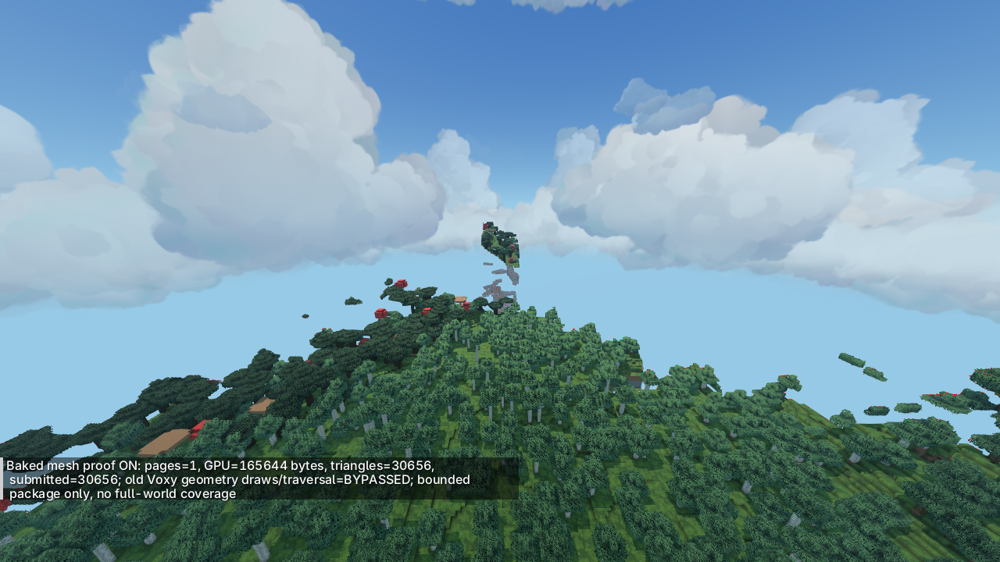
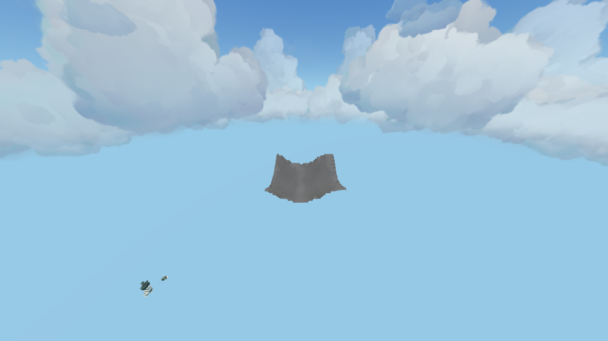

# Первый отдельный baked-page backend, 2026-10-25

Это ограниченный рабочий renderer готовых страниц, **не законченная замена мира**.
Режим выключен по умолчанию. При включении рисуется только загруженный пакет,
остальной дальний мир отсутствует. Это ожидаемая область покрытия прототипа.
Улучшение полного FPS/общей памяти по нему не заявляется.

## Что теперь работает

`BakedMeshBackend` читает `fragment-lod-proof-3` manifest, проверяет SHA-256
палитры и выбранных страниц, загружает уровень2 и рисует его в существующий
LOD color/depth target с общим материалом Fragment Render. Собственный GPU
backend поддерживает оба представления: индексированный QEM mesh и packed quads.
Ограничения:16 страниц,16MiB encoded,8MiB на файл страницы,2048 записей палитры,
600000 triangle corners суммарно. Загрузка пока синхронная на render thread;
это не production streaming. Decode/immutable arrays имеют дополнительную цену
CPU RAM сверх размера файла. Нельзя грузить так всю карту.

При active backend `AbstractRenderPipeline.runPipeline` после setup напрямую
переходит к новому draw/composite. Старые `renderOpaque`, `buildDrawCalls`,
`renderTemporal`, `renderTranslucent`, `innerPrimaryWork`/Hi-Z traversal не вызываются.
`VoxyRenderSystem` также пропускает старое chunk-bound rasterization,
render-distance tracker и model-service tick. Текущий HybridTerrain не готовит
и не рисует поверх него свои плитки. Это взаимоисключающие режимы геометрии.

**Старые менеджеры, потоки и arena512MiB всё ещё создаются VoxyRenderSystem и
остаются резидентными.** Это важный незавершённый этап фабрики/lifecycle; bypass
старого draw не равен освобождению всей старой VRAM/RAM. Есть сохранённые
служебные upload/composite/SSAO операции. Режим OFF возвращает старый pipeline.
Полного отключения всех компонент Voxy как модульной зависимости здесь нет.

## GPU layout

- Общая вершина QEM занимает8B: точные локальные координаты1/256 блока в полях
  x15/y17/z15 с offset1 и oct8×2 normal. Непредставимые координаты отклоняются.
  Ошибка позиции сверх кодека страницы не добавляется. Нормаль уже была oct8 в
  странице; при GPU repack она нормализуется/снова кодируется, побитовая идентичность
  нормалей всем значениям не обещается. Проверены направления и единичная длина.
- Материал/исходная face/light хранятся отдельно по4B на triangle в SSBO.
  Fragment shader читает `gl_PrimitiveID`: разрывы материалов больше не требуют
  дублировать позиции и нормали. Для <=65536 vertices используется uint16 index.
- PackedQuads остаются8B/quad в GPU SSBO; instanced indexed draw использует
  четыре вершины/шесть общих индексов и декодирует углы по face. Перевода всех
  quads в большой поток float-вершин больше нет. Малый EBO12B на страницу.
- Таблица face-material содержит UV sprite bounds и tint/material32B на запись,
  шесть записей на palette entry. Используется действующий Minecraft atlas,
  а не отдельная копия текстур всего ресурспака.

Первая реализация разворачивала все грани и дублировала material seams: реальная
страница занимала2127616B. Она была отвергнута в этой же итерации; финальный путь
этого не делает. Это не сравнение с прошлой опубликованной версией или с Voxy FPS.

## Материалы и совместимость

Читаются сохранённые block state properties и biome IDs; sprite выбирается
отдельно для шести направлений, tint берётся через ModelFactory/общий Render provider.
Простой material classifier пока распознаёт листья, grass_block/dirt и обычные
поверхности. UV привязаны к мировым координатам и фильтруются через textureGrad.
Адаптер превращает шесть receiver inputs Render в явно заполняемые fragment
variables, чтобы передать per-triangle light/material без повторного vanilla lightmap.
Нормаль сглаженной поверхности передаётся High; atmosphere применяется в composite.
Код Fragment Render в этой итерации не изменён.

Это **диагностические full-cube** страницы из существующего baker. Произвольные
block models, authored UV rotations, отдельные canopy proxies, корректная дальняя
вода/прозрачность, а также окончательная политика удаления декораций не реализованы.
В частности, не считать такую геометрию готовой заменой stairs/flowers/воды.
Копание/строительство не инвалидируют пакет автоматически; используем неизменённый
тестовый участок. Версия карты/registry/resource pack пока не является production
manifest-контрактом. После reload renderer нужно загрузить пакет повторно.

## Реальная игровая проверка

Мир `Sky_Art_Study`, seed1234, native8чанков,1280×720/FOV90, Vision512блоков,
RenderHigh/shadow2048, тот же ресурспак и Fragment Grass. llvmpipe LLVM19.1.7:
это functional/visual проверка, **не аппаратный FPS**.

1. Из закрытого сохранения экспортирован участок46×384×46 (halo7), origin
   `(473,-64,889)`. Прочитано16 сохранённых чанков, unknown0: [export.json](export.json).
   Итоговая core-страница32×32 располагается на `(480,896)`. Bake:
   [real-bake.log](real-bake.log), [пакет](packages/sky-proof/manifest.json).
2. На этом лесном участке QEM не прошёл cost/error gates и baker выбрал exact
   packed quads. Это не форсированный показ некорректно дешёвого кандидата.
3. Отдельно использована **синтетическая fixture холмов** из CPU-тестов,
   перенесённая в отображение над реальной картой. Это не настоящая гора данного
   мира. Такое размещение позволяет отдельно видеть indexed QEM draw и его свет,
   без перекрытия обычными чанками. Файлы и данные сохранены в
   [qem-floating](packages/qem-floating/manifest.json).

| Данные | Реальная страница | Синтетический QEM |
|---|---:|---:|
| Baseline ScanMesher2D, triangles |30872|1676|
| Выбранный draw, triangles |30656|358|
| Baseline quad payload (геометрия), B |123488|6704|
| Новый GPU geometry, B |122636|5724|
| Новый material table, B |43008|576|
| Всего **новых** GPU buffers, B |165644|6300|

Baseline в таблице — тот же unit-face/full-cube input через shipping scanner,
не фактически снятая вся память оригинального Voxy. Таблицы и общий atlas у
исходного backend также имеют цену, но здесь она не измерена. Новые1676→358
triangles не означают пропорциональный прирост FPS. Большой участок леса ещё
не получил QEM-упрощения. К существующей старой arena эти новые буферы пока
добавляются, даже несмотря на отсутствие старого draw.

Исходные данные воспроизводимы: [source.fvvol.gz](source.fvvol.gz) и
[qem-floating.fvvol.gz](qem-floating.fvvol.gz). BakeProofMain пишет новый каталог
и отказывается перезаписывать существующий. OBJ debug output для runtime не нужен.





Кадры просмотрены. Видимые края/пустота вокруг страницы — отсутствие остального
пакета, не готовая атмосферная маскировка мира. Эти изображения не являются
художественной приёмкой, сравнением равной дальности или готовыми гладкими горами.

Переключение `mesh off`→`mesh on` проверено в клиенте. Отдельная испорченная
палитра с неверным SHA отклонена; уже загруженный QEM остался active с теми же
358 submitted triangles/6300B. GPU/runtime log — [client.log](client.log).

## Проверки

Java21 `build -x test` прошёл: [build.log](build.log). Это build, не Gradle unit tests.
10 реальных GLSL variants (старые6 + indexed/quad backend ×reverseZ) компилируются:
[shaders.json](shaders.json).

`MeshGpuLayoutCheck` и `PackedQuadGpuCheck` создают deterministic vectors.
`check_mesh_gpu.py` исполняет **shipping vertex shader** через transform feedback:
6000 координат совпадают побитово, осевые нормали верны;600 packed quads/2400
corners всех шести направлений совпали с CPU по position, normal, face/material/light.
Лог: [gpu-layout-check.log](gpu-layout-check.log). Это целевые новые проверки;
не запускался повторно весь неизменённый QEM regression suite из прошлой итерации.

## Управление и следующий шаг

Разместить manifest/palette/pages в `run-water/lod-packages/NAME` (gameDirectory
обычного профиля может называться иначе). Команды:

```text
/voxy mesh load NAME
/voxy mesh
/voxy mesh off
/voxy mesh on
```

`load` выбирает level2; это ручной диагностический выбор, не screen-error traversal.
В новом коде попытка включить старый hybrid поверх активного mesh отклоняется.
Загрузка/рендер страницы возможны только в NormalRenderPipeline с материалом Render.
Изменения не включаются автоматически у обычного игрока.

Далее: самостоятельный lifecycle без старой arena/производителей; ограниченный
loader/residency; terrain/trees/material maps, чтобы реальные холмы проходили
бюджет QEM; покрытие представительной сцены несколькими уровнями; native ownership
и швы; ревизии/tombstones; затем равный по покрытию аппаратный A/B. Переход между
независимыми страницами не считать доказанным GPU morph/collapse history.


Runtime JAR SHA256: `3d717787b45efffc39224babc03ecfcae71ca824de86ddb572809749737039a6`.
Финальная сборка также содержит последующий guard команды legacy hybrid; сам
этот guard в загруженном клиенте не упражнялся. Код draw/layout/shaders соответствует
проверенному в игре. После проверки выполнено Save and Quit, все dimensions сохранены,
renderer и workers завершились штатно.

Воспроизведение GPU fixtures: после компиляции CPU-проверок выполнить
`MeshGpuLayoutCheck`, `PackedQuadGpuCheck`, затем
`MESA_GL_VERSION_OVERRIDE=4.6 MESA_GLSL_VERSION_OVERRIDE=460 python tools/lod/check_mesh_gpu.py`.
`tools/lod/check.py` теперь также запускает оба генератора, а GPU-проверка остаётся
отдельной командой. Shipping shaders проверяются через `tools/check_hybrid_shaders.py`
с `--render-root /path/to/fragmentrender`.
