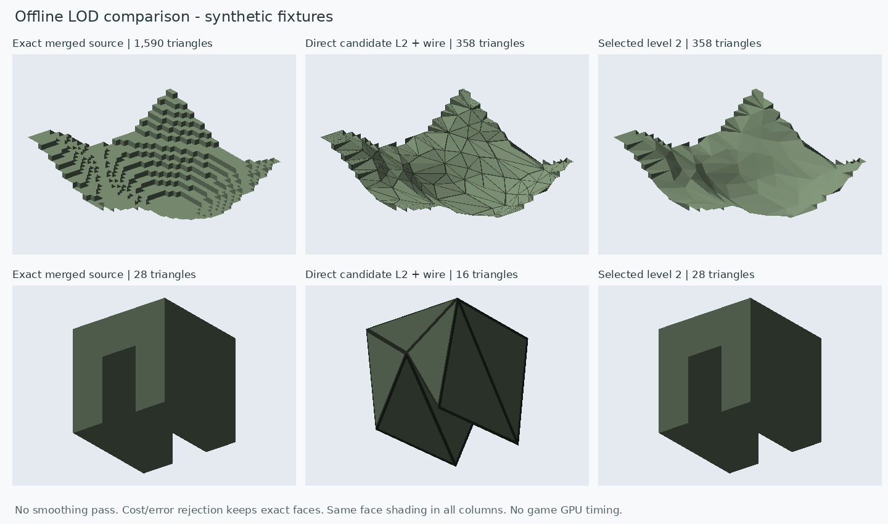

# Прямое упрощение геометрии: сравнение с текущим портом Voxy

Новый путь **не сглаживает исходную сетку**. Он строит согласованную объёмную
поверхность из объединённых граней и непосредственно схлопывает её рёбра.
Гладкость появляется там, где можно заменить ступени более редкой геометрией.

Сравниваются одинаковые unit-resolution объёмы 32×32, visible faces,
state/biome/light keys и мировые 32-блочные scan domains. Baseline — неизменённый
shipping `ScanMesher2D`, предел rectangles 16×16. Это геометрический baseline
текущего порта, не полный RenderDataFactory или аппаратный игровой A/B.

[Числа](offline-proof/comparison.json), [проверки/hashes](offline-proof/validation.json),
[алгоритм и запуск](offline-proof.ru.md). Требуются JDK 21 и Python.

| Сцена | Voxy triangles / payload B | Наш exact triangles / payload B | Выбранный L2 triangles / payload B |
|---|---:|---:|---:|
| Плоскость | 8 / 32 | 2 / 8 | **2 / 8** |
| Холмы, один материал | 1676 / 6704 | 1590 / 6360 | **358 / 3328** |
| Рваный рельеф | 4542 / 18168 | 4244 / 16976 | **4244 / 16976** |
| Арка | 64 / 256 | 28 / 112 | **28 / 112** |
| Защищённая плоскость | 8 / 32 | 2 / 8 | **2 / 8** |
| Material/light patches | 180 / 720 | 180 / 720 | 180 / 720 |
| Плоскость рядом со ступенью | 8 / 32 | 2 / 8 | **2 / 8** |

На холмах L2 — индексированный mesh: **в 4.68 раза меньше triangles, на 50.4%
меньше payload** относительно baseline. Он дешевле и собственного exact-варианта:
на 77.5% меньше triangles, на 47.7% меньше payload. Предыдущий путь «сначала
сгладить unit-face сетку, затем упростить» выбирал 782 triangles / 6508 B на этой
же сцене. Здесь изменены и исходная топология, и правила поиска/приёмки.

Предел расстояния от исходной блочной поверхности на L2 — **1.5 блока**.
Независимая двусторонняя проверка покрывает все треугольники адаптивными
подразбиениями с консервативной оценкой, а не только несколькими пробами.
QEM cost не считается географической ошибкой. Для L0/L1 caps — 0.5/1 блок;
на этой сцене они оставляют точные грани. Уровни пока не связаны с экранными
пикселями или игровой дальностью. Это не сравнение при тождественном силуэте.

На рваном рельефе кандидаты не прошли независимый предел ошибки, поэтому остаётся
exact. На арке mesh из 16 triangles занимает 122 B, а 28 triangles в quads —
112 B: выбираются quads. Уменьшение одного счётчика не скрывает рост другого.
Форма арки и отверстие в выбранном результате остаются точными.

Payload исключает headers/metadata у обоих путей. У quads это 8 B на rectangle;
у mesh — все packed vertices, triangles и attribute dictionary. Это не resident
GPU memory, время shader/decode или FPS. Файл точной плоскости — 32 B
(24 header + 8 payload); его нельзя сравнивать с baseline payload как с полным файлом.

Контуры плиток, material/biome/light seams и авторская защита ограничивают
упрощение. Защита внутри merged rectangle закрепляет весь его полигон.
Добавлен запрет новых контактов вершина/ребро: обычного link condition оказалось
недостаточно, чтобы ребро не прошло через закреплённую вершину контура.
Проверки покрывают winding/area по атрибутам, T-junctions, incidence/Euler на
холмах и арке, точный стык packed/mesh и известные случаи ошибки поверхности.
Это не полная проверка всех возможных self-intersections и малых отверстий.

Синтетические объекты, одинаковое освещение по геометрическим нормалям граней;
это диагностический CPU-рендер без Minecraft textures. На арке средняя колонка
показывает отклонённый кандидат, правая — фактически выбранные точные грани.
Runtime Fragment Vision/Fragment Render пока не подключён. Следующая проверка —
закрытая копия настоящей карты, затем единый draw backend и GPU A/B.
