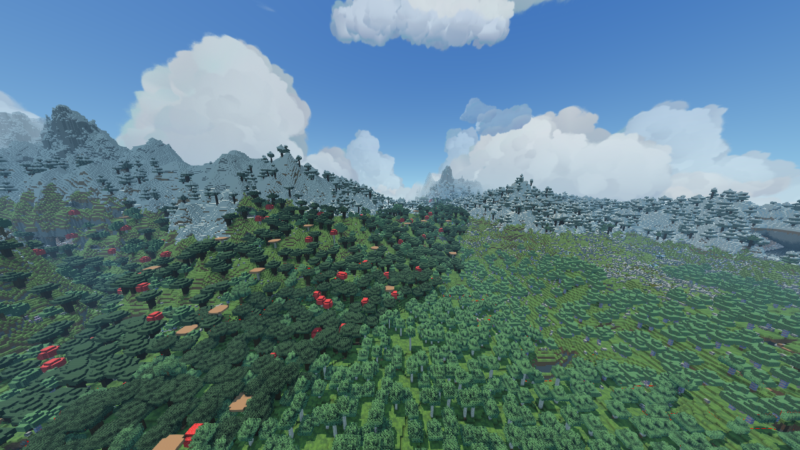

# Полный кадр нового backend, Sky_Art_Study, 2026-10-25

По явному запросу пользователя расширено покрытие baked-page backend на полную
видимую область, вместо одного ограниченного участка. **Старый geometry draw
Voxy в новом режиме не вызывается.** Старые менеджеры/arena остаются резидентными,
как описано в предыдущем proof; это ещё не измеренный выигрыш общей памяти/FPS.

Подготовлено 256 страниц 64×64 блока: X[0,1024], Z[192,1216], Y[-64,320].
Это квадрат 1024×1024 вокруг 512,704 под дальность 512. Источник — закрытый ранее
сохранённый Sky_Art_Study, seed1234, без генерации новых чанков. Экспорт выполнен
64 перекрывающимися snapshots142×384×142 с halo7. Модельные ограничения прежние:
диагностические full-cube формы, без окончательных tree/water/plant policies.

**Во всех 256 страницах QEM не был принят baker: выбран packed-quads fallback.**
Это полноценное покрытие нового renderer, но не полноценное сглаживание гор.
Не выдавать эти кадры за работу нового progressive morph или за более дешёвый
LOD на всей карте. На карте пока отрисовывается точная исходная блочная геометрия
в собственном упакованном формате; деревья тоже остаются кубическими.

Пакет содержит 18183362 подготовленных triangles; encoded выбранных страниц —
72739592B. В игре новые GPU buffers:73650248B (около 70.24MiB), включая таблицу
4759×6 материалов и EBO. Это не вся память Minecraft и не весь Voxy/Render.
Пройден контроль SHA/size всех 256 выбранных страниц и диапазона global material IDs.
Manifest: [package-manifest.json](package-manifest.json), происхождение snapshots:
[source-inventory.json](source-inventory.json).

## Изменения для покрытия

- Явные ограничения loader подняты до 512 страниц,128MiB encoded,192MiB новых GPU
  buffers; ограничение decoded mesh corners —1200000. Packed quads не разворачиваются
  в массивы вершин. Material palette до 8192 записей/4MiB, manifest до 8MiB.
- По реальным bounds каждой страницы добавлен frustum culling. Пустые страницы
  пропускаются. Это не Hi-Z occlusion и не выбор уровня по экранной ошибке.
- Общие material bindings/MVP/параметры камеры переиспользуются между страницами
  одного shader program, вместо повторной привязки на каждый draw.
- `export_section_arrays.py` ускоряет чтение snapshot секциями с numpy. Проверено
  совпадение resolved blocks/biomes, light и natural mask со старым exporter на
  свежем реальном участке и на двух Anvil fixtures, включая unknown samples.
  Gzip output воспроизводим. Numpy нужен только для этого diagnostic helper;
  соответствующий unit test пропускается при отсутствии необязательной зависимости.
- `build_sky_art_frame.py` — воспроизводимый helper именно фиксированной области
  этого мира. Два worker-процесса Java с 512MiB heap каждый; промежуточные страницы
  публикуются имеющимся baker атомарно. После завершения палитры объединяются
  детерминированно, IDs в quad/mesh payload переназначаются с пересчётом SHA.
  Это офлайн capture pipeline, не runtime streaming всей карты.

Сборка Java прошла. Целевые новые unit tests экспортёра прошли: [export-tests.log](export-tests.log).
Семантика кодека/GPU layout не менялась, прежние GPU checks в этой итерации повторно
не запускались. Добавленные bounds/batching проверены полным игровым кадром.

## Кадр

Minecraft1.21.1/NeoForge21.1.262, Sodium0.8.13, native8 чанков, RenderHigh/shadow2048,
1280×720/FOV90, время 4500, SMAA, Fragment Grass и прежний pack. Камера
`(512.0,180.0,704.0)`, yaw0/pitch12. Программный OpenGL llvmpipe; аппаратный FPS
и сравнение одинаковой по детализации сцены с Voxy не выполнялись.

Чистый исходный F2 кадр: `2026-10-25_08.33.41.png`, скопирован без обработки.
В этом ракурсе после frustum culling отправлено 11541890 triangles нового backend;
счётчик включает только его страницы, не native/тени/траву. Это много: сокращение
до реальных LOD уровней и отделение дерева/материалов остаются необходимыми.



На нём должно быть видно заполнение дальнего мира, а не отдельную висящую страницу.
Успешное заполнение кадра не закрывает стоимость 1-block-detail на дальних расстояниях,
швы native/LOD, runtime edits и работу разных уровней. Отдельные художественные
дефекты материалов/света не считать исправленными только из-за полного покрытия.

## Воспроизведение

Сначала подготовить CPU классы baker (`tools/lod/check.py` либо javac его sources).
В этой среде использованы существующие classes из предыдущей проверки.
Для **закрытой** копии мира:

```sh
JAVA_HOME=/path/to/jdk21 python tools/lod/build_sky_art_frame.py \
  --region /path/to/Sky_Art_Study/region \
  --output /path/to/game/lod-packages/sky-full \
  --work /path/to/offline-work
```

Helper отказывается перезаписать завершённый пакет; work относится к одной
неизменяемой копии мира. Не переиспользовать его после правок исходной карты.
В runtime: `/voxy mesh load sky-full`, выключение `/voxy mesh off`.
Файлы страниц порядка 70MiB находятся в рабочем профиле; в Git сохранены manifest,
inventory, код сборки, логи и изображение, а не многогигабайтные OBJ intermediates.

Runtime log: [client.log](client.log). Мир штатно сохранён и закрыт; в логе подтверждено сохранение всех измерений и завершение renderer.
