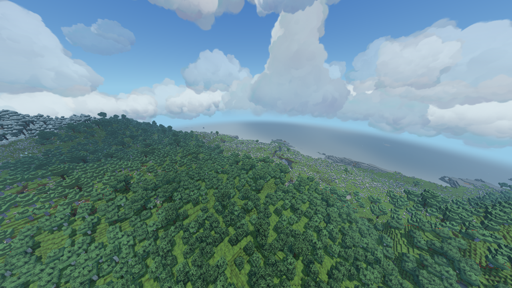
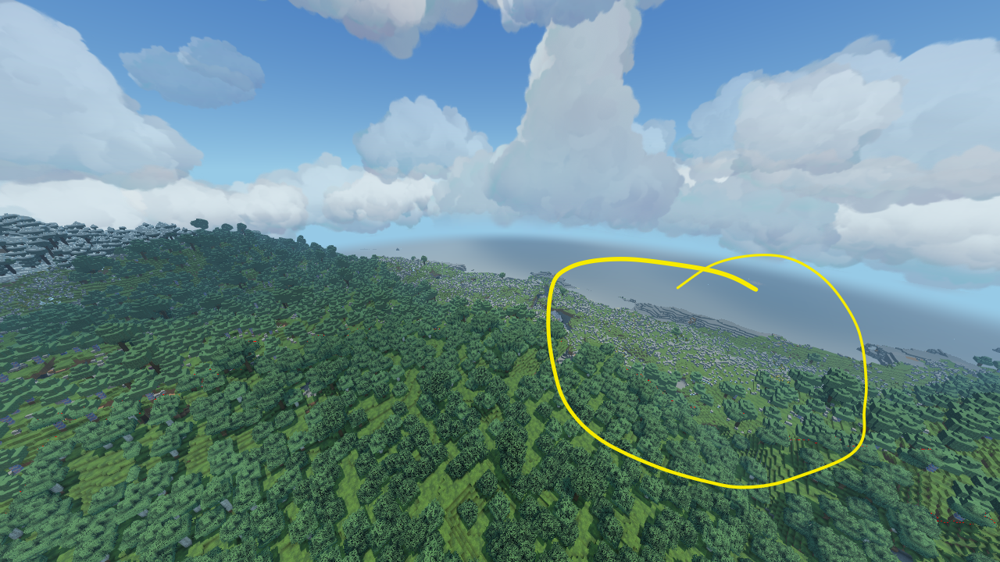

# Сокращение геометрии: WIP, 2026-10-25

Это промежуточная итерация, **не победа над Voxy и не завершённая система LOD**.
Полный предыдущий пакет остаётся сохранён отдельно как `sky-full`.

## Что исправлено

- ConformingSurface больше не считает разницу saved light геометрическим швом.
  Сохранённые light/face/state/biome остаются в атрибутах треугольника.
- Для листьев одной породы и биома свойства distance/persistent больше не
  замораживают геометрию. Разные породы, биомы и защищённые области разделены.
- Проверка новых контактов использует динамический пространственный индекс
  вершин и треугольников. Крупные AABB обрабатываются отдельным overflow-набором;
  после каждого collapse членство обновляется. Точные старые предикаты сохранены.
  При `-ea` каждый результат сравнивается с прежним полным перебором.
- Введён явный opt-in `triangle-priority`: выбранный меш должен сократить число
  треугольников хотя бы на 25%, занять не более 2x encoded payload исходных
  packed quads и пройти прежний независимый двунаправленный distance audit.
  Это обмен памяти на треугольники, а не доказательство ускорения GPU.
  Обычный baker по-прежнему требует не увеличивать ни один из двух показателей.
- `/voxy mesh load` загружает три уровня, объединяя одинаковые файлы в один
  GPU-ресурс с маской уровней. Выбор по расстоянию до footprint: 0 до 192,
  1 до 320, затем 2 (при native 8 chunks). При большей native-дальности
  exact-полоса увеличивается до native+64, средняя — минимум ещё на 128 блоков. В разных страницах допустима разная ширина участка.
  Контур всех уровней остаётся точной единичной решёткой. Morph пока отсутствует.
- Используется общий материал Fragment Render, его биомный tint, sky/cloud shadow
  receivers и атмосферная композиция. В этой итерации shader source не менялся.
  Пробное удаление коэффициента граней отклонено: native High также сохраняет его
  в albedo; изменение одного backend усиливает расхождение native/LOD.
  Новый дальний shadow-caster pass в этой итерации не добавлен.

## Реальные исходные данные

Взяты прежние неизменяемые snapshots b0 и b27, а не заново сгенерированный мир.
Они разбиты на 32x32 страницы вместо 64x64. Это ограничивает сложность каждого
QEM и позволяет обработать лес, не увеличивая лимиты extraction до бесконечности.

| Snapshot | Точные packed quads | Уровень 0 | Уровень 1 | Уровень 2 |
|---|---:|---:|---:|---:|
| b0, рельеф | 41 714 | 41 714 | 37 720 | 27 756 |
| b27, лес | 312 536 | 312 536 | 312 536 | 286 012 |

Числа — треугольники на всю область snapshot, не один игровой кадр.
В b0 приняты 4 mesh-страницы среднего и 10 дальнего уровня из 16; в b27 —
4 дальнего из 16. Остальное честно использует exact fallback.
Метаданные и причины: [рельеф](terrain-manifest.json), [лес](forest-manifest.json).

В игровом пакете `sky-reduced` заменены **только b0 и b27**, остальные участки
взяты из предыдущего полного пакета. Это позволяет проверить mixed quad/mesh
и разные уровни при полном прежнем покрытии. Это не полный rebake карты.

## Проверки и оставшаяся работа

[CPU checks](cpu-checks.log): существующие geometry/topology/codec/distance,
replay, protection, соседние контуры, queue/prefix и экспорт Anvil прошли.
DirectGeometryCheck запущен с `-ea`, включая exhaustive oracle пространственного
индекса. Отдельно проверены leaf visual domains и пределы triangle-priority.
[GLSL](shaders.json): 10 вариантов, packed/indexed, обычный/reverse Z, на llvmpipe.
Сборка Java/мода проходит. Аппаратного FPS A/B нет.

До поставленной цели остаётся существенная работа: лес сокращается слишком слабо;
подсистема крон должна отделиться от exact block surfaces. Нужны runtime streaming,
выбор по экранной ошибке, morph/переход native–LOD, изменения карты, полное покрытие
сокращёнными мешами и корректные дальние caster/occlusion. Сохранённый контур
предотвращает щели между проверенными страницами, но не заменяет контракт с native
chunks и не является доказательством отсутствия любых самопересечений любой карты.
Текстуры берутся из исходного atlas в мировых координатах, без растяжения одной
картинки на весь участок; полноценный визуальный аудит фильтрации ещё необходим.

## Игровая проверка

Запущен тот же Sky_Art_Study, native 8 chunks, Vision 512 blocks, High, 1280x720,
FOV90, SMAA, Grass/RP. Камера (512,180,704), yaw135/pitch25. Материал и shader source
финального запуска совпадают с исходным Render High; эксперимент с ослаблением
направленного затемнения отменён. Mixed-пакет загружен без ошибок: 296 уникальных
GPU-страниц, 74 670 212 bytes. В этом ракурсе отправлено 5 382 210 triangles.
Это не сравнение с прежним кадром другого направления, не FPS-измерение и не
победа над Voxy. Весь пакет имеет 280 пространственных участков и три записи
уровней на участок; большая часть записей ссылается на одинаковые exact pages.

Выявленные визуальные ограничения: дальний лес остаётся слишком блочным и
светлым относительно native. Дальние тени не создаются новым caster-проходом.
Это не замаскировано размытием и не считается решённым. Для следующей итерации
нужно отделить поверхность terrain от крон, отказаться от voxel-by-voxel дерева
и согласовать canopy normals / coarse occlusion / переход с native lighting.

Первый пробный ракурс (256,180,512), yaw135/pitch12 выходил за край baked области;
видимая фоновая плоскость не доказывает ошибку QEM. Из центра покрытие в рабочем
ракурсе присутствует, но произвольное перемещение вне него пока не поддержано.

Исходный чистый F2 финального shader-варианта, без обработки:



## Воспроизведение overlay

После CPU compilation из `tools/lod/check.py` и с прежними неизменяемыми snapshots:

```sh
java -Xmx512m -cp build/lod-proof/classes BakeProofMain \
  /path/to/b0.fvvol.gz /path/to/batches/reduced-b0 32 triangle-priority
java -Xmx512m -cp build/lod-proof/classes BakeProofMain \
  /path/to/b27.fvvol.gz /path/to/batches/reduced-b27 32 triangle-priority
python tools/lod/overlay_sky_art_frame.py \
  --original /path/to/lod-packages/sky-full \
  --batches /path/to/batches --output /path/to/lod-packages/sky-reduced
```

Overlay helper предназначен только для этих двух batches, использует ту же
палитру states/biomes и не перезаписывает существующий output. Это проверочный
пакет; применять его к другой карте нельзя.

Overlay воспроизведён отдельным запуском helper: manifest совпадает с игровым,
проверены размеры и SHA всех файлов для 840 записей уровней. Мир штатно сохранён
(все измерения) и закрыт. Предупреждения отсутствующих моделей RP, звука и ключа
Yggdrasil в client log не относятся к новому backend.

## Зафиксированные замечания пользователя: 12948

Текущее состояние кода перед фиксацией замечаний: Vision `c7427ef2`, ветка
`wip-new-lods`; Render `0daec67`, ветка `wip/hybrid-terrain`, без локальных изменений.
Разработку алгоритма после этого замечания не продолжали.



В жёлтой области видны подозрительные красные точки; на зелёном участке много
серых пятен/граней. Их происхождение **не установлено**. Нельзя объявлять это
каменными выходами стандартной генерации, грибами или ошибками индексов только
по изображению. Совпадение с исходными сохранёнными блоками ещё надо проверить.
Это открытые визуальные дефекты; CPU topology/error checks их не закрывают.

### Обязательная проверка при возобновлении

1. Тот же мир, камера `(512,180,704)`, yaw135/pitch25, время4500 с остановленным
   циклом суток, тот же pack, native-distance, FOV90, High и параметры атмосферы.
   Учесть движение облаков/их теней: зафиксировать фазу или отключить их одинаково
   в обоих режимах, если они мешают сопоставлению цвета.
2. Отключить старый экспериментальный HybridTerrain: `/voxy hybrid off`.
   Снять новый backend через `/voxy mesh load sky-reduced` (или `mesh on`, если
   нужный пакет уже загружен). Дождаться завершения загрузки и стабильного кадра.
3. Не двигая камеру, `/voxy mesh off` — получить портированный Voxy без старого
   HybridTerrain. Дождаться готовности его геометрии/материалов, снять второй F2.
   Статусы обоих режимов записать: надпись BYPASSED должна меняться на normal.
4. Сравнить одинаковые вырезки жёлтой зоны и равнины, затем переключить обратно.
   Если пятна различаются, проверить state/biome/face/material IDs, sprite/UV,
   tint, normals, light и depth overlap именно этих страниц. Если совпадают,
   подтвердить типы блоков по исходному snapshot/обычным чанкам, а не считать
   совпадение двух LOD-renderer доказательством правильности генерации.

Эта парная проверка **в рамках фиксации замечания ещё не выполнялась**.
Скриншот сохраняет обнаруженный дефект, а не результат исправления.
