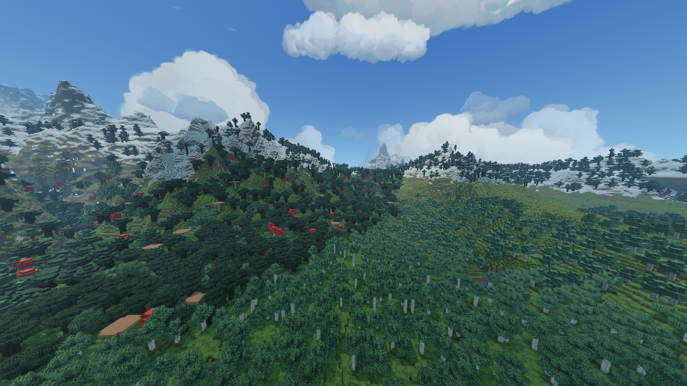
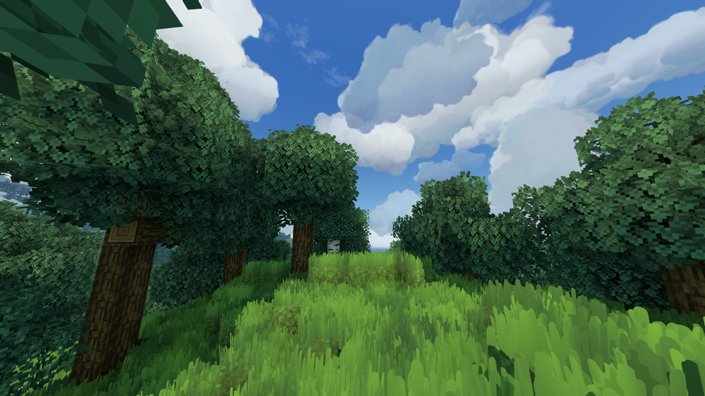

# Проверка wip-new-lods на Sky_Art_Study, 2026-10-25

Проверена полученная ветка Vision `d8bf9085`, затем собраны и запущены описанные
ниже исправления. Render `0daec67` в `wip/hybrid-terrain` совпадает с прежней версией
на GitHub; `sky-clouds` также не обновлялась. Не выполнялось слияние других веток
Render: их содержимое не выдаётся за обновление этого профиля.

## Изменения

- `ProgressiveMeshFile`: отдельный CPU-файл FVPROG01 v1 с исходной поверхностью,
  зависимой историей collapse, SHA-256 и проверкой длины/структуры/размера чтения.
  Запись через атомарную замену файла; bit-exact replay проверен на трёх префиксах
  истории холмов и на промежуточных кадрах малой fixture. Это не завершённый
  manifest/streaming и не включение QEM в игровой draw. Ошибки поверхности по всему
  swept morph всё ещё должны проходить отдельную приёмку.
- В HybridTerrain обычная CancellationException, обёрнутая в CompletionException,
  считается superseded, а не tile build failed. Такой случай воспроизведён при
  первом запуске, когда поступили обновления кэша во время сборки; completed tiles
  сохранялись. Это не OOM и не ошибка компиляции shaders.
- Время сборки теперь подписано elapsed including queue wait, а не CPU.
- `/voxy hybrid earlyCull true|false` управляет уже существующим переключателем,
  ранее доступным только в отдельном aerial-профиле. Статус показывает значение.
- Корневой README и implementation-progress приведены к текущему состоянию.

## Проверки

CPU-проверки `tools/lod/check.py` прошли: bake invariants, стоимость/error кандидатов,
прямое упрощение, зависимая история, очередь worker, соседние контуры, политика
уровней, prefix coverage, упаковка GPU и Anvil→snapshot→pages. 9 Python unit tests
также прошли. [Полный CPU лог](cpu-check.log).

После дополнения round-trip проверки на настоящей зависимой истории:
[history-replay.log](history-replay.log). Побитово сравниваются positions, normals,
indices, faceData и locked у всех трёх уровней. Малый файл fixture —225 байт;
это не оценка размера всей карты. Размер и память полной истории нужно измерять
вместе с индексами/compact pages и working set loader.

Шесть shipping GL variants — linked/standalone opaque/translucent и surface
reverse-Z on/off — компилируются с материалами фактического Render:
[shaders.json](shaders.json). Сборка Java21/Gradle8.14.3 `build -x test` прошла;
она не подменяет отдельно выполненные CPU/GL проверки.

## Игра и осмотр

Тот же сохранённый мир `Sky_Art_Study`, seed1234, прежний импорт6561чанка.
Новая карта для теста не генерировалась. Minecraft1.21.1/NeoForge21.1.262,
Sodium0.8.13, native8чанков, Vision512блоков, FOV90,1280×720, Render High,
shadow2048/radius160, SMAA, Fragment Grass и прежний ресурспак.
GPU: llvmpipe LLVM19.1.7, программный рендер; аппаратный FPS не измерен.

Первый клиент использовал JAR Vision, собранный из исходного `d8bf9085`, SHA256
`601b574575d01dde314eaaa387aa092116e829e3e7765e7183f404f0d4afe046`.
Он проверил новую упаковку64байта на shared vertex в реальной игре.
Лог: [first-client.log](first-client.log).

После поступления изменений кэша первая сборка была отменена. Повторная завершена:
213 tiles, fine/coarse/far=4346506/2478770/1990784 подготовленных triangles,
GPU geometry390MiB, skipped0, GPUfallback0, reused35. Время61500ms — elapsed,
включает ожидание очередей; камера во время сборки направлена вверх, чтобы
освободить CPU программного рендерера. Это не чистое CPU time и не GPU benchmark.
Observed heap1998MiB — выборка на границах tiles, не точный peak всей JVM.
Полный бюджет Minecraft2GiB остаётся тесным; отсутствия ошибки в одном запуске
недостаточно для гарантии устойчивости памяти на всех картах.

На старой проверке такой же набор prepared index totals занимал429MiB добавочной
геометрии; новая упаковка даёт390MiB. Это сравнение счётчика mesh streams, а не
всей VRAM/RAM и не доказательство улучшения frame time. Исходные Voxy buffers
и обе геометрии в гибридном режиме по-прежнему присутствуют.

Обзор: `(512.5,150,700.5)`, yaw0/pitch8, время4500.

Ближний лес: `(612.5,113,564.5)`, yaw100/pitch-10.

Осмотр: ближний High получает солнце, тени и небо; упаковка не привела к shader
compile failure. Однако дальний гибрид художественно не принят: на склонах
видны рваные/перфорированные массы, резкие смены покрытия и старые ступенчатые
кроны. Не считать этот кадр готовым новым LOD-backend. Конкретную причину всех
артефактов по одному изображению установить нельзя.

## Ограничения и следующий этап

В игровом кадре всё ещё HybridVoxelMesh + исходный Voxy draw, не новый
ProgressiveMesh/QEM renderer. Исправления хранения истории его не подключают.
Полноценное владение native sections, связанная hierarchy границ, публикация
пакета с revisions и новый единственный backend остаются следующими этапами.
Преимущество над Voxy по FPS по этому запуску не заявляется.

## Повторный запуск с исправлениями

Runtime JAR SHA256 `1f76f6d8437e5863424c103c5e7e6c70662440965486eb8c5bb1b168c0b332b2`.
Клиент на том же мире успешно создал High pipeline и завершил полный build:
213 tiles, fine/coarse/far=4346506/2478762/1990786, elapsed54988ms,
geometry390MiB, observed heap2000MiB, skipped0/GPUfallback0/reused0.
Небольшое отличие coarse/far totals от первого запуска не выдаётся за улучшение.
При обзорной камере: 2248689 дополнительных triangles, level tiles=[60,53,0].
Дальний индексный уровень в этом конкретном ракурсе не выбран по error gate;
его работоспособность в других ракурсах здесь не подтверждается.

[Раннее отсечение включено](final-cull-on.png) и
[выключено](final-cull-off.png) — F2 после завершения этой сборки; кадр off содержит диагностический чат.
Оба кадра просмотрены. Большой разрыв первого запуска в них не повторился;
переключение earlyCull не даёт основания назвать его единственной причиной.
Отличаются некоторые детали вывода/прогрузки и положение динамического неба,
поэтому pixel-exact эквивалентность также не заявляется. Ступенчатая форма и
переходы между массами леса остаются видимыми. Изоляция артефакта смешанного
состояния/перестройки — дальнейшая работа, не закрытая этим codec fix.

Повторный клиент не показал Hybrid upload/shader failure или OOM. Исправленная
подпись elapsed видна в логе. Обработчик wrapped cancellation собран и загружен,
но отдельный принудительный cancellation-тест на этом втором клиенте не проводился.
Исходный отказ с нормальной отменой сохранён в первом логе.

[Лог финального клиента](final-client.log). После осмотра выполнено Save and Quit; все dimensions сохранены, renderer и workers завершились.
