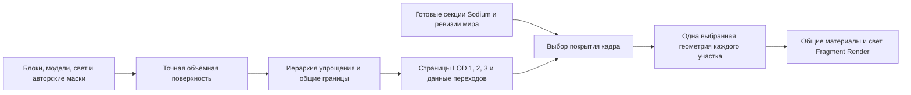

# Три уровня LOD в Minecraft: план реализации

Дата: 2026-10-24. Статус: **проект следующих изменений, не реализованная игровая система**.
Документ фиксирует решение до дальнейшей разработки. Он уточняет разделы об уровнях,
стыках и порядке реализации в [общем плане](README.ru.md). Проверенный CPU-прототип
описан в [отчёте](comparison.ru.md), будущие аппаратные измерения — в
[протоколе производительности](performance.ru.md).

Начатую реализацию и оставшиеся ограничения отслеживать в [журнале работ](implementation-progress.ru.md).

## 1. Какой результат нужен игроку

Рядом остаются настоящие чанки Minecraft/Sodium. За ними последовательно работают
три уровня **дополнительно к настоящим чанкам**:

| Зона | Что видно | Как экономим |
|---|---|---|
| Настоящие чанки | Полные блоки, модели, актуальные изменения мира | Обычный Sodium |
| LOD 1 — ближний | Точный стык с блоками; дальше ступени постепенно заменяются склонами | Объединение граней и ограниченное локальное упрощение |
| LOD 2 — средний | Более редкие склоны, сохранённые гребни, обрывы, заметные арки и постройки | Более крупные участки и более сильное упрощение |
| LOD 3 — дальний | Силуэт ландшафта и крупные узнаваемые формы | Крупные полигоны и отдельные простые представления объектов |

Гладкость получается при упрощении геометрии. Удаление мелких деталей не должно
превращать камень, снег, лес и здания в одно цветовое пятно. Геометрическая и
материальная детализация имеют отдельные ограничения.

Три уровня — три доступных класса качества, а не требование рисовать три сплошных
кольца любой ценой. На плоскости один quad может подходить всем уровням. Скала
может дольше требовать LOD 1/2. Первое доказательство готовности: на обычных холмах
существуют три полезные ступени детализации с согласованными переходами, а не
две ссылки на блоки и один резко отличающийся дальний меш.

## 2. Что есть сейчас и чего не хватает

`TileBake` выбирает независимых кандидатов с caps 0.5/1/1.5 блока. На тестовых
холмах первые два результата — exact quads, третий — mesh 358 triangles / 3328 B.
Выигрыш относительно сканера Voxy относится к одной выбранной поверхности.

Текущий сборщик не сохраняет историю схлопываний, соответствие уровней, общую
иерархию границ или переходную геометрию. `MeshPage` не содержит morph-данных.
Канонические контуры всех плиток закреплены по блокам: это полезный тест стыка,
но не годится как окончательное решение для всего дальнего ландшафта.

Новый пакет не подключён к игровому draw. Старый `HybridTerrain` — другой WIP:
`NormalRenderPipeline` вызывает его после основного opaque-прохода. Переносить
этот способ наложения в новую систему нельзя: отправка исходной геометрии и
отбрасывание её фрагментов не убирают стоимость исходных вершин и буферов.

## 3. Основное решение

Подготовить **связанную иерархию объёмной поверхности**. Упрощатель сохраняет
разрешённые операции схлопывания и зависимости между ними. Из этой иерархии
получаются компактные страницы трёх уровней и небольшие данные перехода для
активной пары уровней. В игре выбирается согласованное покрытие поверхности.

Не строить всю карту заново при перемещении камеры. Движение меняет выбранные
страницы, готовые варианты границ и параметры перехода. Извлечение из блоков
нужно для офлайн-пакета и изменившихся областей мира.

### Пространственные единицы

- Граница передачи между Sodium и LOD привязана к **render sections 16×16×16**,
  включая Y. Квадратная маска по XZ не описывает пещеры, мосты и частично готовые
  высокие чанки.
- Начальный кандидат для геометрических узлов — кубы 32³, 64³ и 128³ блоков,
  выровненные по миру; родитель объединяет восемь детей. Это параметры испытания,
  не утверждённые оптимальные размеры. Пустые объёмы не получают геометрию.
- Вблизи native узел можно раскрыть до секций 16³ и точных граничных patches.
  Это служебное уточнение внутри LOD 1, а не четвёртое пользовательское качество.
- Текущий офлайн tile 32×32 на всю высоту — прототип. Перед runtime нужны
  ограниченные по высоте страницы и общие границы по всем шести направлениям.
- LOD 3 объединяет детей и удаляет ненужные внутренние разрезы. Если оставить
  отдельный дальний меш на каждую мелкую плитку, цена краёв, metadata и draw
  selection ограничит экономию. Для очень большой карты может потребоваться
  дальнейшая глубина иерархии внутри дальнего класса; три размера не гарантируют
  приемлемую стоимость на любой дальности.

Пещеры и навесы остаются объёмными. Нельзя заменить каждый XZ одной верхней Y.
Для камеры под горой расстояние оценивается в 3D; поверхность рядом с камерой
не становится дальней из-за положения на карте.

## 4. LOD 1: передача от настоящих блоков

### Источник границы

Ввести реестр готовности native-секций: координаты, ревизия блока/света,
поколение ресурсов, состояние GPU upload и принадлежность к native-покрытию.
Готовая пустая секция — известный пустой объём, а не «нет данных».

В текущем `MixinRenderSectionManager` есть точка `updateSectionInfo` / `setInfo`,
но существующая логика следит в основном за сменой нулевых/nonzero flags. Этого
недостаточно: нужно различать повторную загрузку непустой секции, готовую пустую
секцию, удаление, отменённую сборку и устаревший результат. Точный hook завершения
GPU upload следует подтвердить на используемой версии Sodium. Один `setInfo`
ещё не считается доказательством готовности всех ресурсов для рисования.

Владение не зависит от того, прошла ли секция текущий frustum/occlusion culling.
Невидимая, но готовая native-секция не должна внезапно передаваться LOD при
повороте камеры. `ChunkBoundRenderer` полезен как существующая точка интеграции,
но текущую маску нельзя автоматически объявить новым протоколом владения.

### Точная линия и переходная полоса

1. Разделить точную исходную поверхность на patches, которыми можно владеть
   на границе секций. Прямоугольник или треугольник, пересекающий границу владения,
   предварительно разделяется; нельзя выкинуть его целиком по центру треугольника.
2. На самом стыке сохранить реальные координаты, контуры, материал и способ
   привязки текстуры. Для первых испытаний — opaque full-cube terrain. Лестницы,
   заборы, жидкости и модели модов требуют своих точных представлений.
   Диагностические кубы из текущего exporter для этого непригодны.
3. Снаружи границы выделить полосу постепенного разрешения упрощения. Начальный
   параметр для эксперимента — 16–32 блока, а не фиксированная гарантия качества.
   Нулевое перемещение на стыке, плавно растущий допуск внутри полосы, затем
   обычный LOD 1. Контур и все зависимости операции остаются согласованы.
4. Сохранять достаточно подробную топологию в полосе. Уже схлопнутый грубый mesh
   нельзя превратить обратно в блоки простым перемещением оставшихся вершин.
   Точная форма восстанавливается разрешёнными обратными операциями иерархии.
5. Для локальной операции использовать расстояние её **полной области влияния**
   до native-покрытия, включая исходные и целевые треугольники. Ограничение только
   по одному концу ребра может сдвинуть геометрию через точный стык.

Практическая модель допуска: `eAllowed = min(eScreen, eTier × smoothstep(0, W, d))`,
где `d` — консервативное расстояние области операции до native-покрытия, `W` —
ширина полосы. Это правило отбора операций, а не готовая формула безопасного
перемещения всех вершин. Для переходов отдельно проверяется вся траектория.
Расстояние по объёму может консервативно оставлять лишние детали на соседних
стенках пещеры — это приемлемее разрыва на неоднозначной поверхности.

### Движение границы

При загрузке native сначала уточнить соответствующий LOD до точной поверхности
и подготовить новые соседние границы. Затем, после готовности native, атомарно
передать ему участок на границе кадра. Пока геометрия LOD приходит к точной форме,
новая native-секция может быть уже загружена, но её terrain draw ещё не выбран.

При уходе native сначала подготовить актуальный точный LOD replacement, передать
ему участок и только затем разрешить упрощение. Нужен ограниченный запас страниц
вокруг движущейся границы и протокол удаления секции до освобождения GPU-данных.
Нельзя рассчитывать, что произвольную выгрузку Sodium всегда удастся задержать:
до неё требуется готовая копия актуального граничного представления. Если это
не обеспечено hooks/budget, бесшовная передача ещё не реализована.

Реестр сам по себе не выключает native draw. Нужна отдельная интеграция в
формирование/отправку списков terrain draws Sodium: секция с готовым upload,
которой ещё владеет LOD, временно не отправляется в native terrain pass. Проверить
все relevant passes и совместимость batching; точный метод/инъекцию выбрать по
исходникам установленного Sodium. Подмена visibility flags ради этого может
сломать его culling и не принимается без отдельной проверки.

Меняется единое владение terrain patches. Отдельно согласовать cutout/water;
block entities и сущности остаются штатными объектами Minecraft. Их исчезновение
при уходе из native требует отдельного решения, не покрывается упрощением земли.

## 5. LOD 1 → 2 → 3: как убрать скачки формы

### Связанное упрощение

Расширить `QuadricSimplifier`: записывать схлопывания, стабильные идентификаторы,
область влияния, зависимости и соответствие исходных/целевых атрибутов. Из одной
истории получать уровни, а не запускать три несвязанных QEM и пытаться угадать
соответствие ближайшими точками. Ближайшая точка может оказаться другой стенкой
пещеры или стороной арки.

При сборке родителя сварить детей, убрать внутренние служебные швы и продолжить
разрешённое упрощение. Ошибка родителя проверяется относительно оригинала,
не только детей. Границы material/biome, защищённые формы и значимые отверстия
ограничивают допустимые операции; один distance bound не сохраняет топологию.

### Плавное перемещение и смена индексов

Во время перехода рисовать одну подробную топологию с движением к следующему
состоянию. Когда разрешённая группа схлопываний завершена, убрать вырожденные
треугольники и перейти на компактные индексы/вершины следующего состояния.
Обратный переход сначала раскрывает подробную топологию в совпадающей грубой
форме, затем возвращает детали. Родитель и все затронутые дети переключаются
согласованно; большой родительский треугольник может пересечь несколько детей.

Одновременный morph сразу всей цепочки схлопываний **не считается безопасным**.
Начать с независимых групп операций и явно сохранённых зависимостей. Проверять
перевороты/контакты и отклонение на всём интервале движения, а не только в концах.
Для первых групп допустим консервативный запрет при неопределённости; произвольная
выборка нескольких кадров не доказывает отсутствие пересечения между ними.
Не прошедшая проверку группа остаётся подробной, а не меняется резким скачком.

Позиции, общие граничные вершины и progress берутся из одной записи перехода.
Освещение/нормали меняются согласованно; дискретный material ID не интерполируется
численно. Если материал меняет детализацию, требуется своё соответствие карт.

Хранить на GPU только текущую геометрию и необходимые данные активного перехода,
а не все уровни и все morph targets на каждой вершине. Ограничить одновременно
переходящие страницы. Временно более подробная топология и old/new buffers
входят в полную цену; при нехватке ресурсов отложить переход и сохранить готовый
согласованный вариант. Начальный temporal interval 0.2–0.4 s — параметр теста,
не замена пространственной полосы и не обещание невидимости перехода.

## 6. Стыки страниц и соседних уровней

Закрепить в исходных блоковых координатах нужно native-стык и защищённые формы.
Остальные границы получают **общую иерархию контуров**, которую могут упрощать
оба соседа согласованно. Иначе каждые 32 блока останется ступенчатая рамка.

- Общая грань пространственных узлов хранится один раз по стабильному мировому
  ключу. На ней может быть несколько петель/раздельных поверхностей, включая
  выходы пещер. Общие рёбра и углы узлов имеют собственные стабильные ключи.
- Границы квантованы в общей мировой системе с локальными целочисленными offsets;
  одинаковая точка после decode обязана совпадать у соседей, в том числе далеко
  от начала координат и при отрицательных X/Y/Z.
- Соседи отличаются максимум на одну пространственную ступень: 32↔64↔128.
  При переходе 32→128 между ними сначала сохраняется/подгружается 64. Правило
  проверяется и на рёбрах/углах, не только на шести гранях.
- Более грубый сосед принимает нужную детализацию общего контура в узкой
  граничной области; его внутренность остаётся грубой. Триангуляция этой области
  и зависимости доступны заранее. Стыковка не сводится к независимым полоскам
  на каждой грани: угловые конфигурации тоже должны совпадать.
- При переходе обоих соседей общий контур имеет одного владельца состояния и
  progress. Все затронутые страницы публикуются одной согласованной группой.
- Вертикальные «юбки» могут скрыть щель сверху, но создают стены в пещерах и тени.
  Они не принимаются как штатное решение для этой объёмной поверхности.

Не обещать готовый Transvoxel поверх произвольного QEM: его таблицы не являются
универсальной стыковкой любых двух топологий. Основной путь здесь — общие контуры,
иерархия схлопываний и согласованная граничная триангуляция. Если такой путь
окажется слишком дорогим, пересматривать представление границ на малом тесте
до переноса всего мира на новый формат.

## 7. Как выбирать уровень в игре

Выбирать наиболее дешёвую доступную геометрию, которая проходит экранную ошибку,
ограничения native-полосы, важных форм, соседей и актуальности данных.

Оценка для перспективной камеры:

`errorPixels ≈ errorWorld × viewportHeight / (2 × tan(verticalFov / 2) × distance)`.

Использовать близкое к камере расстояние до консервативного объёма поверхности,
расширенного на ошибку/morph, а не расстояние до центра плитки. При пересечении
near plane, нахождении камеры внутри bounds или неопределённости — уточнять.
Формула — инженерная оценка проекции; тест силуэтов и наклонного взгляда нужен
отдельно. Для zoom/FOV/resize пересчитывать выбор без пересборки исходной карты.

Пример: 1080p и **вертикальный** FOV 70° дают фокусное расстояние около 771 px.
Ошибка 1.5 блока на расстоянии 160 блоков — около 7.2 px, на 512 — около 2.3 px.
Следовательно, текущий mesh с допуском 1.5 блока нельзя просто поставить сразу
за native 8 чанков и назвать переход мягким. Значение FOV в меню Minecraft
не подставлять без проверки фактической projection matrix.

Старт для испытаний: целиться примерно в 1 px возле native и до 2 px дальше.
Точные пороги, ширина полосы и скорость перехода подбираются на маршрутах;
не увеличивать скрытно ошибку ради экономии. При таком ограничении часть ступеней
в LOD 1 закономерно сохранится. Подготовить промежуточные состояния упрощения,
чтобы следующий допустимый вариант не начинался только с 1.5 блока.

Добавить гистерезис: например, разрешать огрубление ниже 0.8 целевого порога,
начинать уточнение выше 1.0; учитывать направление движения и загрузку заранее.
Это стартовая настройка, а не доказанный optimum. Резкий zoom/teleport может
потребовать немедленного уточнения готовых страниц; устаревший occlusion history
сбрасывается. В отсутствие страницы остаётся готовый согласованный уровень,
а не дыра. Отсутствующие данные мира не выдаются за известный пустой участок.

## 8. Интеграция Vision и Render

Ниже — проверенные места в текущем дереве и предлагаемые изменения. Новые имена
компонентов являются проектными, соответствующих классов пока нет.

| Место | Изменение |
|---|---|
| `client/mixin/sodium/MixinRenderSectionManager` и accessor менеджера | `NativeSectionRegistry`: upload/removal/empty/revision lifecycle; подтвердить точные hooks Sodium |
| `core/rendering/ChunkBoundRenderer` | Сверить существующие bounds с новым реестром; не использовать одну coarse XZ-маску как доказательство владения |
| `core/rendering/lod/bake/QuadricSimplifier` | История операций, зависимости, группы переходов, ошибки траекторий |
| `core/rendering/lod/bake/ConformingSurface` | Общие границы объёмных страниц; отделить native-ограничения от дальних границ |
| `core/rendering/lod/bake/TileBake`, `MeshPage`, `tools/lod/BakeProofMain` | Версионированный пакет иерархии, seams и переходов; старые proof pages не считать runtime-ABI |
| `core/VoxyRenderSystem`, `RenderPipelineFactory`, `NormalRenderPipeline` | Режим выбора старого backend или нового `LodScene`; подготовка единого покрытия перед draw |
| `rendering/hierachical`, upload arenas, Hi-Z | Проверить повторное использование culling/residency; текущие node/quad layouts не объявлять совместимыми с indexed meshes |
| `WorldEngine.setDirtyCallback` и `WorldUpdater` | Передача invalidation в новый реестр ревизий; сохранить существующих потребителей callback |
| `client/compat/FragmentAtmosphereCompat` | Версионный адаптер общего material/light/depth контракта |
| Render: `AtmosphereBridge`, `WorldLighting` | Расширение проверенного v1 bridge для явного входа новых поверхностей и переходов |

Render просмотрен по имеющемуся локальному review-снимку; перед кодовой интеграцией
нужно сверить актуальную рабочую ветку Render. В снимке уже есть `shaderSource`,
`materialShaderSource`, `bindMaterial`, `releaseMaterial`, `bindAir`. Они не
содержат готового протокола владения native/LOD или morph страниц.

### Порядок кадра

1. Принять готовые upload/revision события, проверить версии ресурсов/мира.
2. Рассчитать целевое покрытие, сбалансировать соседей, запросить недостающие страницы.
3. Выбрать **готовое** покрытие и группы переходов; закрепить их ресурсы до GPU fence.
4. Атомарно зафиксировать owner и transition state для кадра до составления draws.
5. Нарисовать выбранные native и LOD opaque/cutout/water в согласованном порядке.
6. Выполнить необходимый depth/composite и общие эффекты Render; освободить старые
   ресурсы после завершения их последнего использования GPU.

В новом режиме исходный полный MDIC terrain draw не запускается параллельно
новому миру. Exact fallback — собственные выбранные quads/модели в том же наборе
покрытия. Shadow pass имеет свой culling, но согласованные версии геометрии и
переходов; camera frustum нельзя использовать как полный список shadow casters.

Материал получает state/biome, корректную поверхность/UV, albedo, свет и нормали.
Снег не размазывается на каменную стену. На native-стыке сравниваются albedo,
face shade/AO, sky/block light, normals, mip и alpha; совпадение координат само
по себе не устраняет видимую границу цвета. Fog/tone mapping применяются один раз.
Для близких моделей необходимы реальные baked-model данные и актуальный resource
pack; текущие диагностические full cubes и сохранённый face ID этого не заменяют.

## 9. Изменения мира, загрузка и стоимость

Для страницы хранить world/dimension identity, base revision, локальную revision,
версии block/model/material schemas, bounds, error bounds, boundary keys,
child references, codec/checksum и стоимость выбранного представления.
Контентный ключ seams включает ревизии соседей. Старый worker не публикует
результат поверх новой правки или нового resource pack.

При копании/строительстве инвалидируются leaf, область зависимости/halo,
затронутые общие границы и все предки. Сразу обновляются настоящие чанки; снаружи
native используется актуальный точный patch. Родитель со старым рельефом не
может оставаться поверх вырытой ямы: выбрать свежих детей для всего затронутого
участка, при необходимости раскрыть более крупный узел до безопасной границы.
Новый patch заменяет старую поверхность, включая удаление; пустая страница
получает tombstone. Добавочный положительный mesh без удаления старой земли
не решает редактирование. Локальные сохранённые изменения имеют приоритет над
предгенерированным пакетом после перезапуска и возвращения к месту.

До готовности новых переходов изменённая зона может оставаться точной и более
дорогой. Нужны byte/worker/upload budgets, очереди с приоритетом ближайшей зоны,
измеренная задержка и контролируемое поведение при массовых правках. Удалённые
изменения multiplayer нельзя узнать из старого скачанного мира без передачи
сервера: это отдельный источник актуальных данных, не свойство LOD-сборщика.

Пакет хранит все нужные уровни на диске; на GPU резидентны выбранные страницы,
ограниченный запас и активные переходы. Считать vertices, indices, seams,
transition records, material textures, metadata, alignment, staging и old/new
буферы. Текущий proof gate сравнивает payload/triangles одной плитки; переходная
полоса может локально стоить дороже. Её нельзя прятать: принимать новую систему
по **общему** покрытому участку и кадру с той же дальностью/качеством, включая
пиковую память и переходы. Выигрыш 358 triangles на холмах этого ещё не доказывает.

## 10. Порядок реализации и условия готовности

| Этап | Конкретный результат | Проверка перед следующим этапом |
|---|---|---|
| A. Связанные уровни CPU | Collapse history и три полезных состояния на холмах; exact источник; первые переходные группы | Меньше геометрии к дальнему уровню, ограничение ошибки каждого уровня относительно оригинала, проверка всей траектории |
| B. Стыки CPU | Две соседние страницы, затем сетка 2×2×2; разные уровни, углы и родитель с детьми | Совпадение декодированных контуров, отсутствие щелей/дублирования, корректная пещера и арка |
| C. Движущаяся native-граница CPU | Реестр 16³, загруженные/пустые/неготовые секции и перенос полосы | Новый owner выбирается только с готовым replacement; движение границы не требует полного extraction |
| D. Минимальный игровой backend | Один небольшой участок opaque terrain, собственные quads+mesh, depth и диагностический материал | Старый полный terrain pass выключен в новом режиме; кадр содержит одно покрытие; реальные GPU размеры и timings |
| E. Native и Render | Реальные события Sodium, передача владения и общий material/light input | Ходьба и полёт через стык без дыр, скачка формы/цвета; 6/8/12 native чанков |
| F. Streaming и edits | Ограниченные очереди/кэш, zoom/teleport, правки и восстановление после загрузки | Нет возврата старой земли, неверных ревизий и неограниченного old/new расхода |
| G. Материалы и объекты | Снег/скалы, модели, вода, кроны; необходимые дальние тени | Узнаваемые формы и согласованное освещение в трёх уровнях |
| H. Приёмка | Маршруты реальной карты и аппаратный A/B по performance.ru.md | Сопоставимое качество/дальность, выигрыш или отсутствие регрессии полного кадра и памяти |

Полная сборка восстановлена на Java 21 / foojay 1.0.0, исправлен dev-runtime
Sodium и non-mod libraries; подробности в журнале реализации. Перед этапом D
зафиксировать также рабочую версию Render. Standalone checks и CPU smoke внутри
Minecraft не подтверждают готовность нового игрового backend.

Ближайшая кодовая задача — **A вместе с минимальной парой страниц из B**.
Не подключать текущие три независимых результата в игру как готовую систему
переходов. Изменение размера плиток, seamless morph и общего material ABI —
отдельные проверяемые изменения; этот документ не утверждает их готовность.

Обязательные сцены: плоскость, холмы, гребень, вертикальная скала, навес, пещера,
арка, берег, защищённый дом, разные materials/biomes/light на границе. Для стыков:
шесть направлений, углы, отрицательные/большие координаты, квантование, изменение
LOD во время morph и edits, готовая пустая native-секция, teleport и resource
reload. Проверять без fog в диагностике и затем с обычным Render. Изображения
и названия уровней в отчётах делать по-русски; отдельно показывать выбранный
результат, стоимость переходов и отклонённые варианты.

### Нерешённые вопросы, которые нужно закрыть экспериментом

- Цена хранения collapse history и данных безопасного morph относительно компактных
  независимых meshes; достаточность небольших групп без заметных задержек перехода.
- Общие face/edge/corner контуры для сложной многослойной поверхности: число вариантов,
  стоимость collar и сохранность отверстий. Это главный геометрический риск.
- Точные lifecycle hooks установленной версии Sodium, включая empty/upload/remove;
  возможность подготовить replacement до обязательного освобождения секции.
- Размеры 32/64/128, экранные пороги и ширина полосы на реальной карте и GPU.
- Какие material/light швы переносить в карты атрибутов, чтобы не закрепить почти
  все вершины; цена и качество нового входа Fragment Render.

При неудаче отдельного эксперимента сохранить подробный согласованный вариант,
зафиксировать цену/ограничение и исправить соответствующий компонент. Отсутствие
щелей и правильное обновление мира — обязательные условия, а не уступка ради
меньшего числа треугольников.
